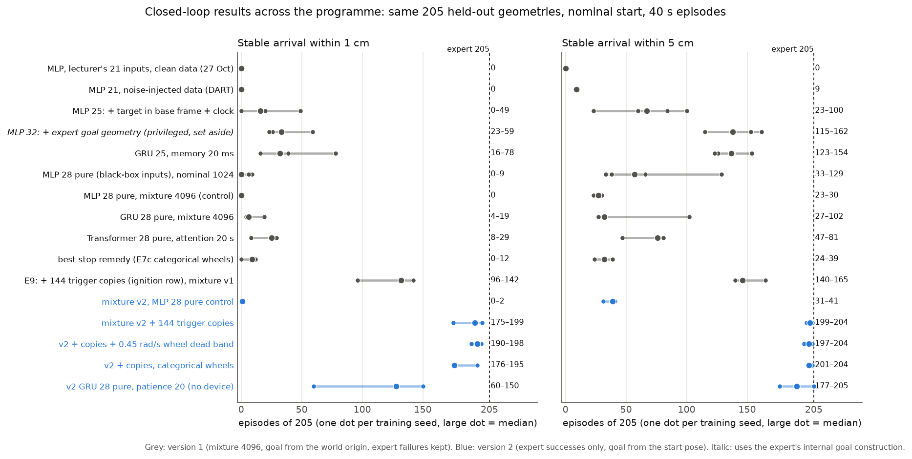
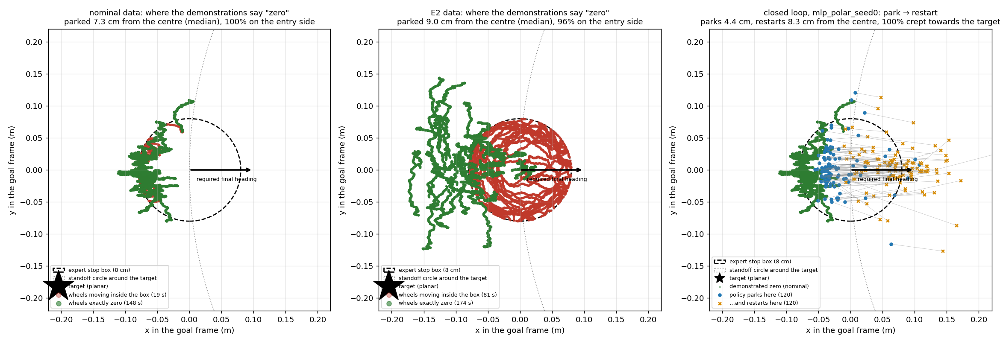
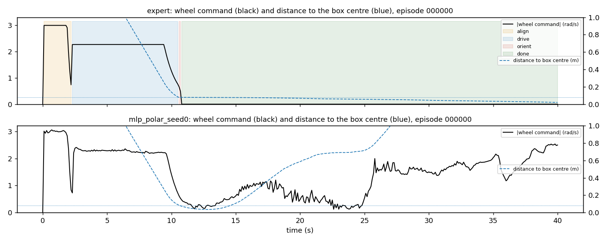
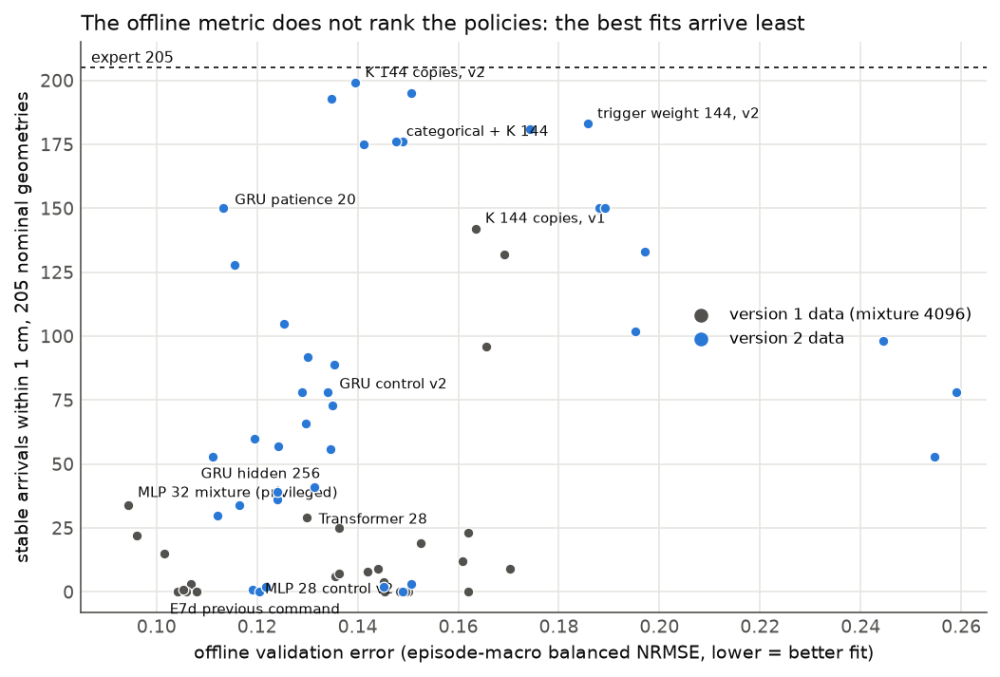
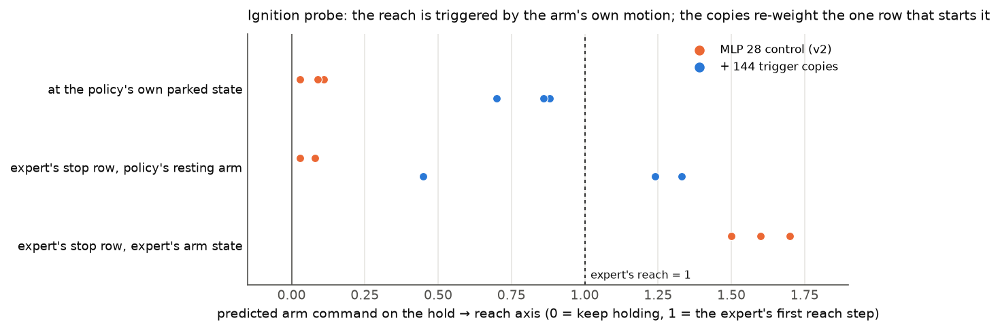
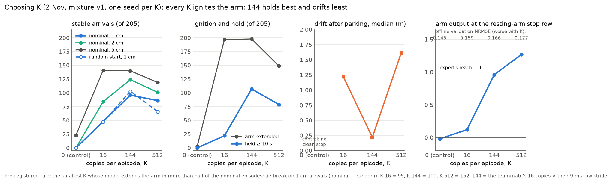
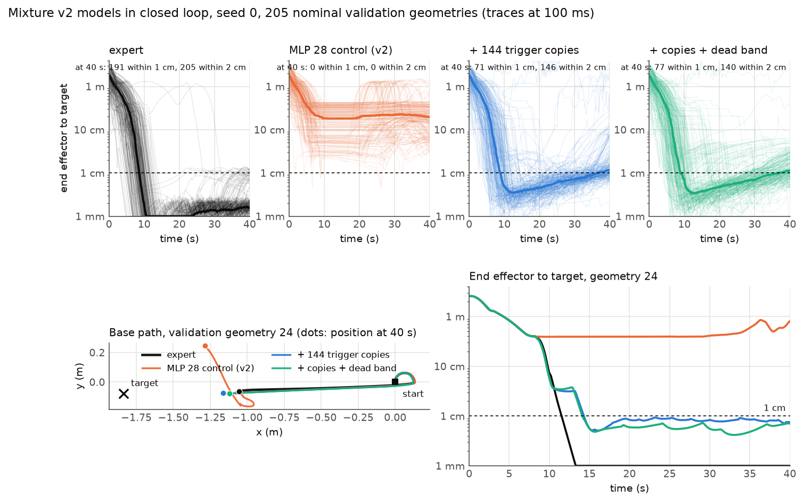
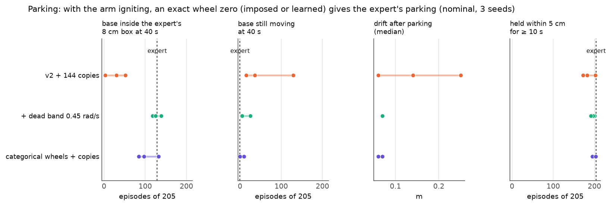

# Behaviour cloning of a hybrid expert: progress report

COMP0245 Machine Learning for Robotics, MSc Robotics and AI, UCL, 2026/27. Branch `rodrigo` (Rodrigo). Status as of
**3 November 2026, 12:00**. This README is the ordered account of the work on this branch: the baseline, what was studied,
how the models improved, which branches were taken and abandoned, and the second version that matches the expert. The
detailed evidence is in `docs/` (section 9 lists every document in reading order); the usage guide of the repository is in
[docs/REPOSITORY_GUIDE.md](docs/REPOSITORY_GUIDE.md).

**The task.** Clone the lecturer's controller for a Robotnik mobile base with a Kinova arm (PyBullet, 1 ms control):
from the 21 observations (base x, y, z, heading; 7 arm angles; 7 arm velocities; target x, y, z) predict the 11 commands
(4 wheel velocities, 7 arm torques) so that the learned policy drives to a standoff in front of the target, parks, and
places the end effector on the target. Episodes last 40 s; the task metric used throughout is the **stable arrival**: the
end effector within 1 cm (also reported at 2 and 5 cm) of the target for at least 0.5 s, measured in closed loop on 205
held-out target geometries the model never trained on.

**Where it stands.**

| | stable arrival 1 / 2 / 5 cm, 205 nominal-start geometries | 205 random-start geometries | teammate protocol (touch 10 mm) |
|---|---|---|---|
| expert (lecturer's controller) | 205 / 205 / 205 | 200 / 200 / 200 | 100% |
| version 1 baseline: MLP on the 21 inputs (25–27 Oct) | 0 / 0 / 0 | — | 0% |
| best of version 1, black-box inputs (2 Nov) | 96–142 / 124–158 / 140–165 | 103–108 / 111–119 / 113–123 | 49–71% |
| **version 2: MLP 28 + 144 trigger copies (3 Nov), 3 seeds** | **175–199 / 194–202 / 199–204** | **187–200 / 196–203 / 199–204** | **86–98%** |
| version 2 + 0.45 rad/s wheel dead band | 190–198 / 196–204 / 197–204 | 189–197 / 194–200 / 199–202 | 94–97% |
| version 2, best model with no label-derived device: GRU 28, patience 40 (3 Nov) | 121–151 / 154–198 / 177–205 | 103–140 / 134–203 / 172–205 | 60–76% |

Three things made the difference between version 1 and version 2, each measured in isolation: an **ignition row** that
re-weights the one demonstration row per episode where the arm starts to reach (section 5.1), **training only on
demonstrations where the expert succeeded** (section 5.2), and **referencing the expert's goal to the robot's start pose**
instead of the world origin (section 5.2). None of them changes the network: the model is still a 21 385-parameter MLP with
two hidden layers of 128.



*Figure 1. Stable arrivals of every model family evaluated on the same 205 held-out geometries (one dot per training seed).
Grey: version 1 (mixture 4096, goal from the world origin, expert failures kept in the data). Blue: version 2. Rows are in
chronological order from top to bottom. Script: `scripts/analysis/progress_figures.py`.*

---

## 1. The expert, and the rule the project adopted

The expert is a hybrid system (`src/robot_learning/expert/controllers.py`, audited in
[MECHANISMS_20261027.md §0](docs/MECHANISMS_20261027.md)). The base runs a four-phase switch keyed on thresholds (align,
drive, orient, done); the last phase is a **latch**: once `done` is set the wheels are exactly zero for the rest of the
episode whatever the base does. The arm holds a fixed posture until `done`, then runs differential inverse kinematics on
the target with an **integrated joint reference** that the observation does not contain. So the expert's command is a
function of three relative angles, two distances, one latched bit and one hidden integrator, none of which is in the 21
inputs. The goal it drives to is not observable either: a standoff in front of the target, along the bearing from the
world origin to the target.

Rule adopted on 27 Oct and kept since ([BLACKBOX_PLAN_20261027.md §0](docs/BLACKBOX_PLAN_20261027.md)): **policy inputs
may be functions of the observations and of the task specification, never of the expert's control law** (no standoff
table, no bearing rule, no thresholds, no phase bit, no simulator state), and the policy has exactly two output groups,
the arm commands and the wheel commands. Everything below respects it; the one model that did not (the 32-input "goal
geometry" MLP) is reported as a reference and set aside.

## 2. Version 1: the baseline and the first studies (23–27 October)

**Pipeline (23–25 Oct).** The lecturer's episode loop was preserved behind one engine shared by the interactive simulator,
the data collector and the evaluator ([ARCHITECTURE.md](docs/ARCHITECTURE.md)); behavioural regression tests check the
expert's trajectories step by step. A parallel collector with provenance (scenarios, seeds, hashes, source snapshot) was
built and profiled ([DATA_COLLECTION.md](docs/DATA_COLLECTION.md), [WORKER_BENCHMARKS.md](docs/WORKER_BENCHMARKS.md)). The
closed-loop evaluator runs the learned policy in a fresh simulator for 40 s with the expert on the same scenarios and
measures the task externally ([AUTONOMOUS_EVALUATION.md](docs/AUTONOMOUS_EVALUATION.md)).

**Baseline (25 Oct).** 64 episodes with uniform targets in a 4 × 4 m box, nominal start pose. A linear regressor and a
128 × 128 MLP on the 21 inputs, 9 outputs (right and left wheel velocity duplicated to the four wheels, 7 torques), scalers
fitted on training episodes only, early stopping on an episode-balanced validation NRMSE
([BASELINE_TRAINING.md](docs/BASELINE_TRAINING.md), [MLP_BASELINE.md](docs/MLP_BASELINE.md)). Offline the MLP cut the
linear model's validation error by 66%; in closed loop both arrived in **0 of 13** scenarios and the MLP diverged to
hundreds of metres ([BASELINE_LIMITATIONS.md](docs/BASELINE_LIMITATIONS.md)). The first lesson of the project: the offline
error says little about control.

**Data scale and sampling (26 Oct).** 64 → 128 → 256 → 512 → 1024 → 2048 episodes, uniform versus spatially stratified
targets, training to patience without an epoch cap, then a PyTorch/CUDA backend to make the series affordable
([SAMPLING_SERIES.md](docs/SAMPLING_SERIES.md), [PATIENCE_SERIES.md](docs/PATIENCE_SERIES.md),
[PYTORCH_TRAINING.md](docs/PYTORCH_TRAINING.md)). Offline error fell steadily with data; closed loop stayed at **0 of 820**
paired goals for both 2048-episode policies ([PATIENCE_PARTIAL_REPORT.md](docs/PATIENCE_PARTIAL_REPORT.md)). Stratified
sampling reduced the divergence (median final base error 2 m instead of 200 m) without producing an arrival.

**Diagnosis (27 Oct).** An external review of the branch ([CLAUDE_ANALYSIS.md](docs/CLAUDE_ANALYSIS.md)) named the cause:
the labels depend on state the inputs do not contain. A pre-registered **privileged-input ablation**
([PRIVILEGED_ABLATION.md](docs/PRIVILEGED_ABLATION.md)) measured it: adding the expert's phase bits and its arm reference as
inputs removes 38% of the supervised error, and three quarters of the arm error after `done`. Two experiments launched the
same day, a 200 ms observation window (201 inputs) and a depth/shape screen, were overtaken by this result: the window
model arrived in 0 of 205 ([TEMPORAL_WINDOWS.md](docs/TEMPORAL_WINDOWS.md)), and the depth screen was not carried to closed
loop ([MLP_DEPTH_AND_SHAPE.md](docs/MLP_DEPTH_AND_SHAPE.md)).

**The first arrivals (night of 27 Oct, [NIGHT_RUN_20261027.md](docs/NIGHT_RUN_20261027.md)).** Three changes, each tested
alone on a 1024-episode stratified dataset and the same 205 held-out goals:

- **Noise injection at collection (DART).** The expert is recorded while executing its own command plus N(0, 0.5 rad/s)
  on the wheels and N(0, 1.0 Nm) on the torques, held for 50 ms; the labels are the clean commands. Without it the policies
  left the demonstrated states within a second and saturated; with it saturation and runaway disappeared. Every dataset
  since uses it.
- **Target in the robot's frame.** Four pure transforms of the lecturer's inputs (target in the base frame, its height,
  planar range, bearing) plus an episode clock. First arrivals: 49 / 67 / 100 at 1 / 2 / 5 cm (seed 0; 0–20 at 1 cm over
  five seeds).
- **Memory.** A GRU with 20 ms memory on the same inputs: 16–78 at 1 cm, 123–154 at 5 cm over five seeds.

A 32-input variant that also handed the policy the expert's goal construction (standoff and bearing rule) reached
115–162 at 5 cm. It was the best model of the week and it is the reason the black-box rule exists: those features encode
the control law, not the observations. [MECHANISMS_20261027.md](docs/MECHANISMS_20261027.md) explains, with
measurements, why each of these changes works.

## 3. The black-box programme (28 October – 2 November): the branches taken

Every arm below: 3 seeds (5 in the first row), DART data, closed-loop evaluation on the same 205 nominal-start geometries
and, from E3 on, on 205 random-start geometries; pre-registered in
[BLACKBOX_PLAN_20261027.md](docs/BLACKBOX_PLAN_20261027.md) before its result, with a measured mechanism after it. Numbers
are stable arrivals at 1 / 2 / 5 cm of 205, nominal start; the full per-run table is
`python3 -I scripts/analysis/final_table.py`.

| Arm (plan section) | inputs | data | 1 / 2 / 5 cm (seeds) | what was measured |
|---|---|---|---|---|
| MLP 28 pure: 21 + target in base frame + polar + clock (§6e) | 28 | nominal 1024 | 0–9 / 2–39 / 33–129 | the six pure features unlock the base and the arm; the policy arrives, then leaves |
| E1 random start poses alone (§6) | 28 | random 1024 | 0 / 0 / 11–17 | start-pose variety without nominal demonstrations loses the nominal task |
| E3 mixture 1024 nominal + 3072 random (§6f) | 28 | mixture 4096 | 0 / 0–1 / 23–30 | the base data of the programme; invariance to the start pose, no hold |
| E4 base velocity as input (§6g) | 31 | mixture 4096 | 0–3 / 0–9 / 37–40 | copycat of its own last motion |
| E4 GRU, memory 20 ms (§6h) | 28 | mixture 4096 | 4–19 / 6–50 / 27–102 | learns the stop as a latch; approaches 10–18 cm off |
| E5 transformer, attention over 20 s (§6j) | 28 | mixture 4096 | 8–29 / 13–43 / 47–81 | best offline fit of version 1, same creep as the MLP |
| E7a stop rows weighted ×8, E7b L1 wheel loss (§6l) | 28 | mixture 4096 | 0 / 0–3 / 9–44 | open-loop residual at the stop 0–1%, closed-loop creep unchanged |
| E7c categorical wheels, 41 bins (§6m) | 28 | mixture 4096 | 0–12 / 2–14 / 24–39 | an exact zero exists; replaced by chatter and a clock-gated stop |
| E7d previous wheel command as input (§6n) | 30 | mixture 4096 | 0–1 / 0–1 / 11–19 | copycat (R² 0.999) or, with input noise, ignored |
| E2 near-target starts added (§6o–§6q) | 28 | mixture 6144 | 0–12 / 0–20 / 13–43 | the new demonstrations teach "rotate" inside the tolerance box |
| E8d wheel dead band 0.45 rad/s at the output (§6t) | 28 | mixture 4096 | 0–25 / 1–50 / 24–94 | the base stops exactly and the arm does not start |
| E8a learned stop gate, E8b MLP→GRU encoder (§6v, §6w) | 28 | mixture 4096 | 0–23 / 1–33 / 5–79 | the gate confirms a stop it never causes |
| **E9: + 144 trigger copies per episode (§6y)** | 28 | mixture 4096 | **96–142 / 124–158 / 140–165** | the ignition row (section 5.1) |

Two findings run through the table:

- **The hold is a latch, and a regression on the current frame cannot represent a latch.** Every stateless model's "zero"
  is a residual of 6–10% of the drive command; it integrates into a creep of 0.2–0.5 m that leaves the thin shell of
  demonstrated stop states in 8–12 s, after which the policy extrapolates to "drive" again. Fixing the zero where there is
  data (E7a, E7b, E7c) does not fix the creep, because the failure happens in states no demonstration covers
  ([STOP_ZONE_EXPLAINED.md](docs/STOP_ZONE_EXPLAINED.md), figures below).
- **The offline validation metric is not a selection criterion for this task.** The policies that fit the demonstrations
  best were, again and again, the ones that arrived least (Figure 2). Model selection in this project is closed loop only.



*Figure 2a. In the goal frame: where the demonstrations say "wheels zero" (the thin shell of stop states) and where the
learned policy ends up after creeping out of it ([STOP_ZONE_EXPLAINED.md](docs/STOP_ZONE_EXPLAINED.md)).*



*Figure 2b. Wheel command of the expert (exact zero after `done`) and of the MLP 28 control (a residual that never reaches
zero, then a restart).*



*Figure 2c. Offline validation error against closed-loop arrivals for every three-seed arm on the mixture data. The
best fits (hidden-256 GRU, the 32-input privileged MLP, the previous-command MLP, the v2 control) are at the bottom left.*

## 4. The diagnosis that changed the programme: two coupled failures

By 2 Nov the stop remedies had produced three models with an exact zero (categorical wheels, the learned gate, the output
dead band) and none of them reached the target. The traces showed why ([§6t.1](docs/BLACKBOX_PLAN_20261027.md)): when the
base stops cleanly, **the arm never starts**. In the demonstrations the reach begins from a *resting* arm on about one row
per 12 000; every other row with a moving arm is already reaching. A regressor learns "arm at rest ⇒ hold", and in version
1 the arm only ever started because the creeping base jostled it. An offline probe (`scripts/analysis/arm_switch_probe.py`)
makes this quantitative: at its own parked state the control policy's arm output lies at +0.03 to +0.11 on the hold → reach
axis (0 = hold, 1 = the expert's first reach step), and the expert's base pose and clock make no difference, only the arm
state does (Figure 3). The two failures feed each other: the base reads the resting arm as "keep driving", the arm reads
the stopped base as nothing.



*Figure 3. The arm's predicted command on the hold → reach axis at the parked state, for the version-2 control and the
version-2 model with trigger copies (three seeds each). With the expert's actual arm state the control predicts the reach
(+1.5 to +1.7): the policy knows how to reach, it does not know when to start.*

## 5. Version 2 (2–3 November)

### 5.1 The ignition row

A teammate's branch (`feature/step3c-trigger-copies`, C3 in their report) had duplicated the first `nav_done` frame of
each training episode 16 times with noise on the arm velocities and gone from 0.3% to 52–70% success under their protocol.
[§6x](docs/BLACKBOX_PLAN_20261027.md) explains it with the diagnosis above: the copies re-weight the one resting-arm reach
row per episode by a factor of 17, and the jitter on the arm velocities spreads that row over the neighbourhood of
resting states the policy actually visits. Their row selection reads the expert's `nav_done` flag; ours derives the row
from the labels alone (the first row of the terminal run of exactly-zero wheel commands, identical to the flag in 78 of
80 episodes), so the device stays within the black-box rule. Implemented in our trainer as `trigger_copies=K` with
`trigger_qd_jitter=auto` (σ per joint = the standard deviation of the arm velocities over the moving rows, fixed seed),
scaler fitted on the recorded rows only, labels unchanged.

**How K was chosen.** The weight that matters is copies against the look-alike hold rows of the same input region. The
teammate trains on one row every 9 ms, so their 16 copies are 1.5% of an episode's rows; we train on every 1 ms row, so
16 copies would be 0.13%. The sweep was pre-registered at **K ∈ {16, 144, 512}** (144 = 16 × 9 keeps their row fraction;
512 sits between their K 64 and K 256), one seed per K, both validations, with the rule fixed before the result: the
smallest K whose model extends the arm in more than half of the nominal episodes, tie-break on 1 cm arrivals over the two
banks ([§6y](docs/BLACKBOX_PLAN_20261027.md)). Every K ignited the arm (197 / 198 / 149 of 205); the tie-break picked
**144** (199 arrivals against 95 and 152). The mechanism check agreed: at the resting-arm stop row the control predicts
−0.02 on the hold → reach axis, K 16 +0.12, K 144 +0.96, K 512 +1.27, and the extra weight of 512 fires the reach early,
from a base 0.24 m off the expert's stop, with the worst drift (Figure 3b). Offline NRMSE worsens monotonically with K
(0.145 → 0.177) while closed loop improves and then degrades. 144 is the best of three pre-registered values, not an
optimum. Seeds 1 and 2 at K 144 on the version-1 data: 96 / 142 / 132 at 1 cm, from 0 ([§6y.2](docs/BLACKBOX_PLAN_20261027.md)).



*Figure 3b. The K sweep on the version-1 mixture, seed 0: stable arrivals, hold and creep, and the ignition probe against
the number of copies per episode.*

### 5.2 Two data rules

Looking at why the copies still missed 60–110 geometries exposed two problems in the data itself
([§6z](docs/BLACKBOX_PLAN_20261027.md)):

1. **The expert fails too, and its failures were in the training set.** 217 of the 3 276 version-1 training episodes
   (605 000 rows, 5% of all zero-wheel rows) were navigation timeouts: the expert circled 8 cm outside its own tolerance for
   25 s, then held zero wheels 2.5 m from the goal with the arm reaching at a target 1.1 m away. Rule adopted: **train and
   select only on episodes where the expert succeeded**; failed scenarios are re-collected with a new start pose and noise
   seed and discarded if they fail again.
2. **The goal was referenced to the world origin.** The lecturer's expert takes the goal bearing from the origin, where
   his robot always starts; with a random start pose that sends the robot around the target to the far side of the
   standoff ring. A collector option `goal_reference: start` (bit-identical for the nominal start) gives the near side.

Mixture v2 = 819 nominal + 2 806 random-start (3 starts per target) + 322 replacement episodes = **3 221 expert
successes** (35.4 M rows); 802 validation episodes for early stopping. A pre-registered ablation
([§6z.2](docs/BLACKBOX_PLAN_20261027.md)) separates the two rules on the same 205 geometries: dropping the failures alone
gives 120 / 134 / 153 at 1 cm; the start-referenced goal makes the jump to 175–199, and removes a drive-away mode.

### 5.3 Results

`v2_mlp28_trig144_seed{0,1,2}`: MLP 128 × 128, 28 inputs, 9 outputs, 144 trigger copies, Adam 1e-3, batch 1024, L2 1e-4,
patience 8, 36 min on the GPU; selection closed loop on the validation geometries. Reserved test banks untouched.

| | 1 / 2 / 5 cm | held ≥ 10 s | arm extended | base inside the expert's 8 cm box at 40 s | drift after parking | teammate protocol success |
|---|---|---:|---:|---:|---:|---:|
| **Nominal start, 205 geometries** | | | | | | |
| seed 0 | **199 / 202 / 202** | 202 | 189 | 30 | 0.06 m | 97.6% |
| seed 1 | 193 / 198 / 204 | 182 | 199 | 3 | 0.25 m | 94.1% |
| seed 2 | 175 / 194 / 199 | 172 | 180 | 52 | 0.14 m | 86.3% |
| expert | 205 / 205 / 205 | 204 | 154 | 129 | | 100% |
| **Random start, 205 geometries** | | | | | | |
| seed 0 | **200 / 203 / 204** | 200 | 175 | 38 | 0.05 m | 97.6% |
| seed 1 | 197 / 203 / 203 | 185 | 195 | 17 | 0.20 m | 96.6% |
| seed 2 | 187 / 196 / 199 | 188 | 183 | 53 | 0.12 m | 91.7% |
| expert | 200 / 200 / 200 | 198 | 159 | 128 | | 97.6% |

The control trained on the same data without the copies arrives 0–2 times: the data rules and the ignition row are both
necessary. The version-2 copies model also fixes the hold for the first time (held 10 s follows the arrivals), and the
probe reads +0.70 to +0.88 at the parked state (Figure 3).



*Figure 4. Top: end-effector distance to the target against time for all 205 nominal geometries (thin lines) and the
median (bold), expert and three version-2 policies, seed 0. The control parks and holds 20 cm away; the copies model
arrives in 10–15 s and holds (its median settles at 1.2 cm: the arm relaxes slightly after arriving, which is why "within
1 cm at 40 s" is lower than the stable arrivals). Bottom: one geometry where the control parks short and drives off at
35 s while the copies models park and reach.*

### 5.4 Parking, fixed

What remained was the base: it parked 10–25 cm from the expert's spot (inside the 8 cm box in 3–52 episodes of 205
against 129) and seed 1 kept creeping. The arm absorbed the error, the task metric did not see it. The two stop devices
that had failed with a sleeping arm were re-tested on top of the copies ([§6ac.1](docs/BLACKBOX_PLAN_20261027.md)):

- **0.45 rad/s dead band on the wheel output** (the same trained models, one threshold taken from the gap between zero
  and the slowest driving command in the demonstrations): 198 / 195 / 190 at 1 cm, drift 0.07 m in every seed, inside the
  expert's box in 118–139 episodes, held 10 s equal to the arrivals, still moving at 40 s in 3 / 25 / 5 episodes
  (was 15 / 129 / 36). Nothing lost at the arrivals; seed 2 gains 15.
- **Categorical wheels (41 bins) + copies**: the exact zero learned inside the model. 176 / 176 / 195 at 1 cm, 201 / 201 /
  204 at 5 cm, held 194–203, no creep; seed 2 is the best model so far at 2 and 5 cm on both banks (random 200 / 204 / 205).



*Figure 5. Parking metrics of the copies model alone and with each stop device, three seeds, nominal start.*

The conclusion of the whole stop programme: the parking error was never a missing zero, it was the coupling. With the reach
igniting, an exact zero, learned or imposed, gives the expert's parking.

### 5.5 The other models on version 2

Everything else was re-run on the version-2 data so the comparison is fair ([§6aa–§6ac](docs/BLACKBOX_PLAN_20261027.md)):

| model (3 seeds, nominal 1 cm) | result | reading |
|---|---|---|
| MLP + trigger row loss weight 144 (no copies, no jitter) | 150 / 181 / 183 | the weight alone gives most of the gain; the copies' jitter adds the rest |
| MLP + action chunking (10 × 20 ms) | 3 / 2 / 0 | the executed head still sees one ignition row |
| GRU 28, no device at all | 78 / 78 / 73 (5 cm 158–175) | the only model that ignites the arm with no label-derived device |
| GRU 28 + trigger weight 144 | 150 / 133 / 102 | the weight transfers to the sequence model |
| GRU 28 + weight + jitter | 130 / 77 / 105 | the jitter does not transfer |
| GRU 28, pure, tuned: hidden 256 | 34 / 30 / 53 | best offline fit of the programme (0.111), arrives least |
| GRU 28, pure, tuned: patience 20 | 128 / 60 / 150 (5 cm 191 / 177 / 205) | the pure GRU keeps improving in closed loop after the offline curve flattens; the best pure model so far |
| GRU 28, pure, tuned: stride 10 ms, lr 3e-4, 4 episodes per batch | 36–57, 41–92, 56–105 | no gain |
| **GRU 28, pure, tuned: patience 40** | **138 / 121 / 151** (5 cm 177 / 193 / 205; random 118 / 103 / 140) | every seed above the control; returns diminish past patience 20 (+10 / +61 / +1 for 2–3× the updates); the best model with no label-derived device (seed 2: 151 / 198 / 205, held 10 s in 193) |
| GRU 28 + weight 144, patience 20 | 114 / 58 / 148 | training the weighted GRU longer does not help (two seeds lose, one gains); line closed |
| gated stop (E8a) + weight 144 | 98 / 78 / 53 | on v2 the gate closes 44–53 ms *before* the label zero; on v1 it only confirmed a stop |
| gated stop, no device | 20 / 20 / 107 | the early closing is a property of the data (137–218 ms before the zero), not of the weight |

The second GRU round ([§6ab.2](docs/BLACKBOX_PLAN_20261027.md)) settles what the device costs and buys. The best model
that uses no label-derived device is the GRU 28 trained to patience 40: 121–151 at 1 cm, 154–198 at 2 cm, 177–205 at 5 cm
over three seeds, with the creep gone and the hold intact. Against it, the trigger copies on the MLP are worth about 50
arrivals per seed at 1 cm, 20–30 more ignitions (the pure GRU's arm leaves home in 133–184 episodes, the MLP's in 180–199)
and an arrival inside 1 cm rather than between 1 and 2 cm. Inside the GRU family the offline NRMSE and the closed loop
finally move together (0.134 → 0.105 as the arrivals go 73–78 → 121–151); across families the inversion of Figure 2c stands.

## 6. The best model, stated plainly

Full report: [BEST_MODEL_REPORT_20261103.md](docs/BEST_MODEL_REPORT_20261103.md). The policy is a stateless MLP
(28 → 128 → 128 → 9, ReLU) that maps one observation row to the two wheel velocities and seven torques at 1 ms, trained
with squared error on 3 221 expert-success demonstrations recorded with noise injection, with the target expressed in the
robot's frame and an episode clock as the only non-geometric input. The one device is the trigger copies: a re-weighting
of the demonstrations by a label-derived rule (equivalent to a per-row loss weight of 145 plus input noise). It uses no
information the dataset does not contain, but it is an engineering decision about which row matters, and the report says
so. The optional wheel dead band is a declared threshold on the output. No privileged information enters at any point, and
the reserved test banks (`datasets/test_reserved/*`) have never been loaded by a trainer, a selection step or an analysis.

Reproduction (datasets and splits in the artifact tiers, [ARTIFACT_SYNC.md](docs/ARTIFACT_SYNC.md)):

```
pixi run --manifest-path ../RoboEnv/pixi.toml -e ml python scripts/train_egocentric.py \
  --dataset datasets/dart_stratified1024_low/20261027T060538Z_dart_stratified1024_wheel0_5_torque1_0_hold50_97ab75da \
  --split runs/splits/v2_mixture.json --config experiment_specs/training/mlp_pytorch_successes.json \
  --output-dir runs/training/v2_mlp28_trig144_seed0 --horizon-s 40 --device cuda \
  --inputs raw21_targetpolar_clock_v1 --option trigger_copies=144
pixi run --manifest-path ../RoboEnv/pixi.toml -e ml python scripts/evaluate_policy.py \
  --split runs/training/mlp_stratified1024_torch_baseline/split.json \
  --model mlp28_trig144_seed0=runs/training/v2_mlp28_trig144_seed0 --allow-cross-split --allow-external-holdout \
  --config experiment_specs/evaluation/validation.json --workers 8 \
  --output-dir runs/evaluation/v2_mlp28_trig144_on_clean_validation_20261102
```

## 7. Caveats

- **Seeds.** Three per arm, always reported separately; the spread at 1 cm is 175–199 for the best model.
- **Protocol.** Our 1 / 2 / 5 cm stable arrivals with a 0.5 s dwell are stricter than the teammate's 10 mm touch; their
  metrics computed from our traces are approximate (100 ms sampling).
- **What the comparison with the teammate's C3 shows.** Same network family and the same ignition mechanism, reached
  independently; the difference between their 52–70% and our 86–98% under their protocol is the data (twice the
  demonstrations, noise injection in every episode, the two data rules) and the inputs (the lecturer's 21 raw inputs kept
  next to the transforms, plus the clock).
- **The window, depth and near-target-start branches** were closed by measurement, not by preference; the reasons are in
  the plan sections cited in the table of section 3.
- **DAgger** (expert relabelling of the policy's own states) is the textbook remedy for both failures and was deliberately
  not used: the expert has memory that the observation does not determine, so a relabelling protocol needs that memory
  reconstructed first ([BASELINE_LIMITATIONS.md](docs/BASELINE_LIMITATIONS.md), L2).

## 8. Running now and next

- Nothing on the GPU: the GRU round two is done (§5.5). A third pure round (patience 80) is possible but the trend says a
  few arrivals for an hour of GPU.
- Decision between the dead band and the categorical head for the final policy; then the reserved test banks, once, for
  the report.
- Report (6 pages IEEE) and the in-person demonstration.

## 9. The documents, in reading order

`docs/` holds every study of the branch as it was written, day by day. Read in this order:

**Setup and tooling (16–26 Oct)**

| document | what it answers |
|---|---|
| [RESEARCH_PLAN.md](docs/RESEARCH_PLAN.md) | the initial plan, bibliography and rubric; §17.1 the questions for the lecturer |
| [EXPERIMENT_NOTES.md](docs/EXPERIMENT_NOTES.md) | the first ideas discussed (box, nominal start, density vs extent) |
| [ARCHITECTURE.md](docs/ARCHITECTURE.md), [SIMULATOR.md](docs/SIMULATOR.md) | how the lecturer's code was preserved and refactored; running the expert |
| [DATA_COLLECTION.md](docs/DATA_COLLECTION.md) | the collector, provenance and recipes |
| [WORKER_BENCHMARKS.md](docs/WORKER_BENCHMARKS.md), [COLLECTION_PROFILING.md](docs/COLLECTION_PROFILING.md), [PERFORMANCE_FACTOR_ANALYSIS.md](docs/PERFORMANCE_FACTOR_ANALYSIS.md), [MARGINAL_WORKER_SCALING.md](docs/MARGINAL_WORKER_SCALING.md) | how many parallel workers, and why 16 |
| [MULTI_MACHINE.md](docs/MULTI_MACHINE.md), [ARTIFACT_SYNC.md](docs/ARTIFACT_SYNC.md) | working across two computers; moving datasets and runs |

**Version 1: baseline and diagnosis (25 Oct)**

| document | what it answers |
|---|---|
| [BASELINE_TRAINING.md](docs/BASELINE_TRAINING.md) | the data contract, the split, the scalers, the linear baseline |
| [BASELINE_ERROR_INTERPRETATION.md](docs/BASELINE_ERROR_INTERPRETATION.md), [PER_JOINT_ERRORS.md](docs/PER_JOINT_ERRORS.md) | what the offline errors mean, joint by joint |
| [MLP_BASELINE.md](docs/MLP_BASELINE.md) | the 128 × 128 MLP and its selection protocol |
| [AUTONOMOUS_EVALUATION.md](docs/AUTONOMOUS_EVALUATION.md) | the closed-loop evaluator and the first 39 rollouts (0 of 13) |
| [COMMAND_FIDELITY.md](docs/COMMAND_FIDELITY.md), [COMMAND_ERROR_AND_DIVERGENCE.md](docs/COMMAND_ERROR_AND_DIVERGENCE.md) | tolerance profiles; where the first deviations occur (before any clipping) |
| [BASE_ARM_STOPPING_DIAGNOSTICS.md](docs/BASE_ARM_STOPPING_DIAGNOSTICS.md), [BASE_AND_SYSTEM_TRAJECTORIES.md](docs/BASE_AND_SYSTEM_TRAJECTORIES.md), [TRAJECTORY_FIGURES.md](docs/TRAJECTORY_FIGURES.md), [SATURATION_AND_ORIENTATION.md](docs/SATURATION_AND_ORIENTATION.md) | base vs arm vs stop; trajectory figures; saturation onset |
| [BASELINE_LIMITATIONS.md](docs/BASELINE_LIMITATIONS.md) | L1 unbounded outputs, L2 why DAgger is not straightforward |
| [RESEARCH_LOG.md](docs/RESEARCH_LOG.md) | the running log of decisions and results through 27 Oct |

**Version 1: data scale and sampling (26–27 Oct)**

| document | what it answers |
|---|---|
| [SAMPLING_COMPARISON.md](docs/SAMPLING_COMPARISON.md), [SAMPLING_SERIES.md](docs/SAMPLING_SERIES.md), [DATASET_SIZE_COMPARISON.md](docs/DATASET_SIZE_COMPARISON.md), [DATASET_SIZE_TRAJECTORIES.md](docs/DATASET_SIZE_TRAJECTORIES.md) | uniform vs stratified targets, 64 → 512 |
| [TRAINING_STOPPING.md](docs/TRAINING_STOPPING.md), [PATIENCE_SERIES.md](docs/PATIENCE_SERIES.md), [PATIENCE_PARTIAL_REPORT.md](docs/PATIENCE_PARTIAL_REPORT.md) | patience vs epoch caps; 1024 and 2048 episodes; still 0 arrivals |
| [PYTORCH_TRAINING.md](docs/PYTORCH_TRAINING.md) | the CUDA backend, equivalent to the sklearn recipe |
| [SUPERVISED_ERROR_BY_SUBSYSTEM.md](docs/SUPERVISED_ERROR_BY_SUBSYSTEM.md), [SUPERVISED_FULL_VALIDATION.md](docs/SUPERVISED_FULL_VALIDATION.md), [FULL_VALIDATION.md](docs/FULL_VALIDATION.md), [TARGET_SPACE_COVERAGE.md](docs/TARGET_SPACE_COVERAGE.md), [VALIDATION_GEOMETRY.md](docs/VALIDATION_GEOMETRY.md) | learning curves by subsystem; whether the validation geometry favours a design |
| [CONTROL_METRIC_PROPOSAL.md](docs/CONTROL_METRIC_PROPOSAL.md), [ROBUST_CONTROL_PATTERNS.md](docs/ROBUST_CONTROL_PATTERNS.md) | trajectory-similarity metrics; robust summaries and difficult goals |
| [NEXT_EXPERIMENT_ORDER.md](docs/NEXT_EXPERIMENT_ORDER.md), [TEMPORAL_WINDOWS.md](docs/TEMPORAL_WINDOWS.md), [MLP_DEPTH_AND_SHAPE.md](docs/MLP_DEPTH_AND_SHAPE.md) | the planned order; the 200 ms window and the depth screen |

**The turn (27 Oct)**

| document | what it answers |
|---|---|
| [CLAUDE_ANALYSIS.md](docs/CLAUDE_ANALYSIS.md) | the external review: the expert is a hybrid system with hidden state; proposals P1–P8 |
| [PRIVILEGED_ABLATION.md](docs/PRIVILEGED_ABLATION.md) | how much of the error the hidden state explains (38%) |
| [NIGHT_RUN_20261027.md](docs/NIGHT_RUN_20261027.md) | DART, the frame change, the GRU: the first arrivals, with every artefact path |
| [MECHANISMS_20261027.md](docs/MECHANISMS_20261027.md) | why each of those changes works, from the expert's equations |

**Version 1 → 2: the black-box programme (27 Oct – 3 Nov)**

| document | what it answers |
|---|---|
| [BLACKBOX_PLAN_20261027.md](docs/BLACKBOX_PLAN_20261027.md) | the whole programme, pre-registered section by section: §0–§5 the rule and the plan; §6–§6q E1–E5, E7, E2; §8 the closing synthesis of version 1; §6r–§6w the stop remedies; §6t.1 the ignition diagnosis; §6x–§6y the trigger copies; §6z–§6ac version 2; §7 the status log |
| [STOP_ZONE_EXPLAINED.md](docs/STOP_ZONE_EXPLAINED.md) | the stop region, the demonstrated zero rows and the policy's creep, drawn |
| [BEST_MODEL_REPORT_20261103.md](docs/BEST_MODEL_REPORT_20261103.md) | the best model: what it contains, the chain of decisions, reproduction |

## 10. Repository and usage

```text
src/robot_learning/      expert, simulation engine, collector, learning (MLP, GRU, gated, transformer), evaluation
scripts/                 launchers: simulate, collect_dataset, train_egocentric, train_gru, evaluate_policy, ...
scripts/analysis/        the measurement scripts cited in the documents (probes, profiles, tables, figures)
experiment_specs/        expert rules, collection recipes, training configs, evaluation protocols (versioned)
tests/                   123 tests: behavioural regressions of the expert, collector, trainers, evaluator
docs/                    the documents above; docs/figures/ the committed figures
datasets/, runs/         generated data, models and evaluations (ignored by Git; see ARTIFACT_SYNC.md)
```

Environment, simulator, collection, training and evaluation commands: [docs/REPOSITORY_GUIDE.md](docs/REPOSITORY_GUIDE.md).
Tests: `python -m unittest discover -s tests -v`. The expert and the interactive task originate from
[V. Modugno's COMP0245 starter](https://github.com/VModugno/LAB_SESSION_COMP_0245_2026_PUBLIC/tree/cae4fb69386872ae73c601ce77e182aad7abe284/final/robotnik_arm_task);
the Git history is retained and the original behaviour is checked by the regression tests.
