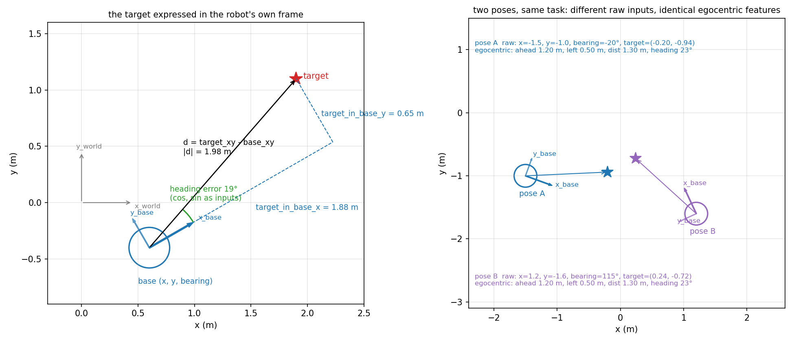

# 2. Inputs and outputs

What the policies see and what they command, why the inputs are transformed, and the evidence for each choice. Code:
`src/robot_learning/learning/features.py` (inputs), `outputs.py` (outputs). Nominal validation bank (205 held-out
targets), five seeds unless marked; tables in [results.md](results.md).

## 2.1 The 21 observations of the brief

| group | values | unit | frame |
|---|---|---|---|
| base position | x, y, z | m | world |
| base bearing | yaw | rad | world |
| arm joint angles | q1 … q7 | rad | joint |
| arm joint velocities | q̇1 … q̇7 | rad/s | joint |
| target | x, y, z | m | world |

These are exactly the inputs of the lecturer's baseline (`INPUT_NAMES`). Every model receives all 21 unchanged; the
transforms below are **added**, never substituted.

**The problem with world coordinates.** The base and the target are given in the world frame. What the controller needs
is relative: "the target is 1.9 m ahead and 0.6 m to the left". From world coordinates the network has to learn that
relation itself, i.e. a rotation by the robot's bearing that is different for every heading, from a finite set of
demonstrations. The same situation seen from two different poses produces completely different inputs (right panel
below), so the network must see every combination of position, heading and target to generalise.

## 2.2 The egocentric transforms

*Left: the quantities computed from the observations. Right: two robot poses facing the same relative situation; their
raw inputs differ in every coordinate, their egocentric features are identical (`scripts/figures/egocentric_frame.py`).*

With d = target_xy − base_xy and ψ the base bearing:

| feature | formula | meaning |
|---|---|---|
| `target_in_base_x` | cos ψ · d_x + sin ψ · d_y | how far ahead of the robot the target is (m) |
| `target_in_base_y` | −sin ψ · d_x + cos ψ · d_y | how far to the robot's left (m) |
| `target_height_above_base` | target_z − base_z | height to reach (m) |
| `target_distance_xy` | ‖d‖ | planar distance to the target (m) |
| `cos_heading_error_to_target`, `sin_…` | cos / sin of atan2(target_in_base_y, target_in_base_x) | direction of the target relative to the heading |

- **A rigid change of frame, nothing more.** The first three are the target rotated into the robot's frame (rotation
  by −ψ); the last three are the same vector in polar form. There is no learned parameter and **no expert knowledge**:
  no base goal, no standoff, no phase. Every value is computed from the 21 observations of the current step, so the
  policy remains a black box on the brief's inputs.
- **Why cos and sin instead of the angle.** The heading error jumps from +π to −π when the target passes behind the
  robot; a network would see a discontinuity where the physical situation is continuous. (cos, sin) is continuous and
  bounded.
- **Why both Cartesian and polar.** The drive is naturally polar (turn until the heading error is small, then drive the
  distance); the stop and the arm's reach are naturally Cartesian (the target 0.65 m ahead, at a given height). Both are
  given; the network picks what it needs.

## 2.3 The clock

`episode_clock_fraction` = elapsed episode time / 40 s, computed by the controller itself (one step per call). The
expert's behaviour depends on time (its navigation timeout, the stop rule's minimum time), which no observation carries.
Risk: a clock lets the network learn "stop at 10 s" instead of "stop at the dock". The out-of-range banks rule this out
for the final model: from far starts (drives 1.7–6 m, longer than any demonstration) the robot arrives later than any
training episode and still parks and starts the arm in 181–205 of 205 episodes ([results.md](results.md) 1.3), so the
stop and the ignition are read from the egocentric and arm features, not from the clock.

## 2.4 What is not given

- **No expert state**: no phase, no navigation flag, no base goal, no arm reference. These exist in the recordings for
  analysis only (`diagnostics_only` in the dataset schema).
- **No measured wheel speed.** The brief's 21 inputs carry no base velocity, and adding the measured wheel speeds causes
  the *copycat* problem: the expert's wheels are velocity controlled, so the measured speed reproduces the previous
  command (R² = 0.99), and a single-frame regressor learns "keep doing what you did": it starts at rest, copies zero,
  and the base never moves. Measured in the group's controlled experiments (experiment A,
  [controlled_experiments/README.md](../controlled_experiments/README.md)); the inputs here never include them.

## 2.5 Outputs

| output | unit | |
|---|---|---|
| right wheel, left wheel | rad/s | the expert commands the four wheels pairwise equal per side: [right, left, left, right] |
| arm torques 1 … 7 | N·m | gravity-compensated PD torques of the expert |

The model learns **nine** independent outputs and `expand_actions` rebuilds the eleven commands; the loader checks that
every recorded pair is exactly equal (never averaged). Inputs and outputs are standardised with the mean and standard
deviation of the training rows. In closed loop the evaluator clips the commands to the expert's envelope (±5.27 rad/s
wheels, ±30 N·m torques); no other limit or filter is applied (the dead band variant of chapter 6 is declared
separately).

## 2.6 Evidence: what the transforms change

Same recipe, same data; MLP-Base = 21 inputs + clock (22), MLP-Ego = + the six egocentric features (28).

| | MLP-Base | MLP-Ego |
|---|---|---|
| offline validation NRMSE | 0.159 (0.151–0.169) | **0.120** (0.119–0.122) |
| base parked at the expert's dock (seeds 0 / 1 / 2, of 205) | 94 / 93 / 137 | 123 / 137 / 116 |
| base drift after parking (median) | 0.59–1.52 m | **0.10–0.30 m** |
| stable arrivals 5 cm (five seeds) | 27.4 ± 22.2 | 39.0 ± 4.6 |
| stable arrivals 1 cm | 1.6 ± 3.6 | 2.0 ± 1.6 |
| **with the ignition copies (chapter 5), 1 cm, seed 0** | **15** | **199** |

- The transforms make the base behaviour consistent: it parks at the dock and stays within 10–30 cm, instead of parking
  and drifting away by metres, and the seed spread collapses (5 cm: ±22 → ±5).
- On their own they do not produce arrivals, because the arm never starts (chapter 5). But they are what makes the fix
  of chapter 5 work: with the same ignition copies, the raw-input model reaches 1 cm in 15 of 205, the egocentric model
  in 199. The arm can only finish from a base parked at the right place, and placing the base needs the target in the
  robot's frame.
- The lidar variant (92 inputs: the 28 + 64 ranges in the base frame, beam 0 forward, counter-clockwise, clipped at 4 m)
  is used for the obstacle tasks only ([07_obstacles.md](07_obstacles.md)).
