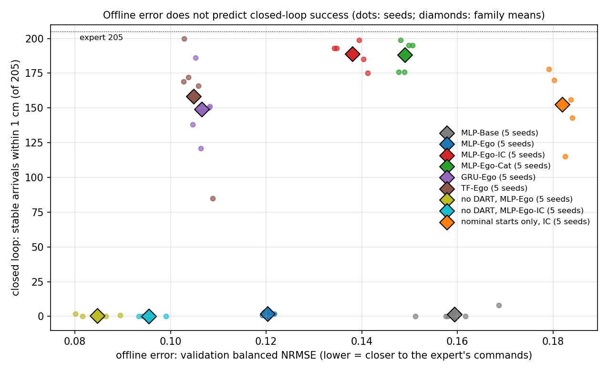
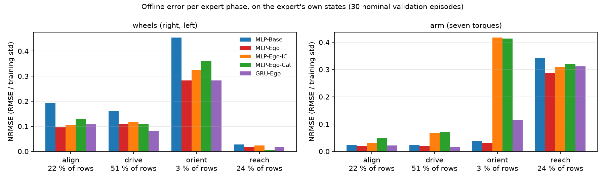

# 4. Evaluation: offline error vs closed-loop success

How the policies are evaluated, the metrics of the report, and the central observation that the offline error does
not predict whether the robot arrives. Code: `src/robot_learning/evaluation/` (`scripts/evaluate_policy.py`), statistics
`scripts/evaluation/`. Results: [results.md](results.md).

## 4.1 Two evaluations

**Offline**: the model's commands on the expert's own states (validation episodes), compared with the expert's commands.
Primary offline metric: the **balanced NRMSE**, per episode the RMSE of each output divided by its training standard
deviation, averaged half over the two wheels and half over the seven torques, then over episodes. Cheap, used for model
selection.

**Closed loop**: the model drives the simulated robot alone, from the same start pose and towards the same target as a
held-out expert episode. This is the task the brief asks for.

## 4.2 Closed-loop protocol (`experiment_specs/evaluation/validation.json`)

- fresh simulator and model state per episode; the expert's physics, controllers and rules are untouched;
- **40 s horizon with no stop rule**: the policy runs the whole 40 s, so leaving the target after reaching it counts;
- commands clipped to the expert's envelope (±5.27 rad/s wheels, ±30 N·m torques), clipping counted; no other filter
  (the dead band is a declared variant, `validation_deadband045.json`);
- the expert is evaluated on the same scenarios under the same protocol, as the reference row;
- every rollout is checked against its source episode (identical initial observation) and stored with a 100 ms trace.

## 4.3 Metrics

| metric | definition | why |
|---|---|---|
| **stable arrival within 1 / 2 / 5 cm** (primary) | the end effector stays within the tolerance for 0.5 s at some point of the 40 s | 1 cm is the expert's own success tolerance; the 0.5 s dwell excludes passing through the target; 2 and 5 cm show near misses |
| held 10 s | the end effector stays within 5 cm for at least 10 s (100 ms samples) | the hold (chapter 6) |
| base parked | the base satisfies the expert's own parking test (8 cm, 0.05 rad) for 0.5 s | separates the base half of the task |
| arm active | the largest arm-joint excursion exceeds 0.1 rad | separates the arm half (every expert episode ≥ 0.195 rad, a sleeping arm ≤ 0.08) |
| final and closest end-effector distance | at 40 s / minimum over the episode | the shape of the failures |
| clipping, joint-limit violations | fraction of steps | how far the policy leaves the expert's envelope |

**Seeds**: every model is trained with five seeds; cells are mean ± sd (min–max) over the seeds
(`scripts/evaluation/seed_stats.py`); no cell reports the best seed alone. The spread between seeds is large for the
sequence models (sd 24–49 arrivals) and must be shown.

## 4.4 Evaluation banks

| bank | targets | start | used for |
|---|---|---|---|
| nominal validation | the 205 held-out cells of the target grid | the lecturer's start | main table |
| random-start validation | the 205 held-out cells | uniform in [−2, 2]² m, any heading | generalisation to initial conditions |
| far targets, target height, far starts | outside the training box | — | generalisation beyond the training range |
| adversities | nominal | nominal | robustness: wheel calibration, payload, observation noise, command delay |

No model is ever trained on a validation target cell, and the banks outside the range are never trained on.

## 4.5 The offline error does not predict closed-loop success



*One point per trained seed: best validation NRMSE (x) against stable arrivals within 1 cm of the 205 nominal targets (y).
Note: the no-DART controls are validated on clean episodes and the nominal-only model on nominal episodes, so their x
values are not on exactly the same validation set; the ordering within the main families is.*

- **The best fits never arrive.** Without DART the model reproduces the demonstrations best of all (NRMSE 0.085–0.095)
  and arrives 0 times; MLP-Ego (0.120) arrives twice.
- **Among the working models the ordering is inverted.** GRU-Ego and TF-Ego fit better than MLP-Ego-IC (0.105–0.106
  against 0.138) and arrive less often (149–158 against 189), with a much wider seed spread.
- **The fix that works makes the fit worse.** The ignition copies raise the offline error (0.120 → 0.138) and raise the
  arrivals from 2 to 189 ([05](05_arm_ignition.md)).

**Why.** The offline error is measured on the expert's states. In closed loop the policy visits its own states, and the
outcome is decided by a few of them that the demonstrations barely contain: the instant the arm must start (one row per
episode), the parked base (where a regressor's "zero" is not zero), the states just off the expert's path (covered only
by DART). Offline, every model copies every phase of the expert closely:



*Normalised error per expert phase, on the expert's own states (30 nominal validation episodes, seed 0): the models
differ little, and the differences do not follow their closed-loop ranking.*

So the offline error is a selection criterion within one family and seed, not a measure of the task; the report ranks
models by closed-loop arrivals over five seeds.

## 4.6 Reproducing the evaluations

With `PY="pixi run --manifest-path ../RoboEnv/pixi.toml python"`:

```bash
# the evaluation splits: nominal bank (= the 205 held-out cells of the clean nominal collection) and random-start bank
$PY scripts/data/make_train_val_split.py runs/splits/nominal_bank.json NOMINAL_CLEAN_DIR
$PY scripts/data/make_train_val_split.py runs/splits/reaching_validation_random_start.json VALIDATION_RANDOM_START_DIR
# closed loop: the expert is always included; several models (e.g. the seeds of one family) per run
$PY scripts/evaluate_policy.py --split runs/splits/nominal_bank.json \
    --model mlp_ego_ic_seed0=runs/training/mlp_ego_ic_seed0 --model mlp_ego_ic_seed1=runs/training/mlp_ego_ic_seed1 \
    --allow-cross-split --allow-external-holdout --workers 16 --output-dir runs/evaluation/mlp_ego_ic_nominal
#   variants: --config experiment_specs/evaluation/validation_deadband045.json (+DB),
#             validation_gain_left095 / _obsnoise[_tenth|_half] / _payload0p1kg|0p25kg|0p5kg / _delay2ms|5ms|50ms
#   banks outside the range: --split runs/splits/bank_<name>.json (scripts/data/make_bank_split.py)
# statistics
python3 scripts/evaluation/summarize_eval.py runs/evaluation/mlp_ego_ic_nominal
python3 scripts/evaluation/seed_stats.py runs/evaluation/<dir> [runs/evaluation/<dir> ...]   # mean ± sd (min–max)
python3 scripts/evaluation/arm_base_decomposition.py runs/evaluation/<dir>                   # base parked, arm active, hold
```

`--allow-cross-split` and `--allow-external-holdout` let one bank evaluate models trained on another split; the
evaluator still rejects any scenario whose physical condition appears in a model's training set, and checks that the
expert, physics and robot assets match the data the model was trained on. The ported evaluator was checked against the
report's runs: identical traces and metrics for the expert and MLP-Ego-IC.

Static and moving obstacles are evaluated in the group's harness (`controlled_experiments/obstacle_task/evaluate.py`,
with `scripts/obstacle/rl_obstacle_policy.py:make_policy` as the policy) and with `scripts/obstacle/dynamic_obstacle.py
--policy`; see [07](07_obstacles.md).
