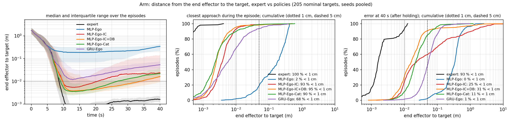
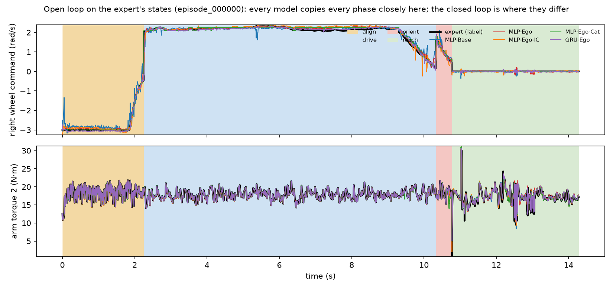
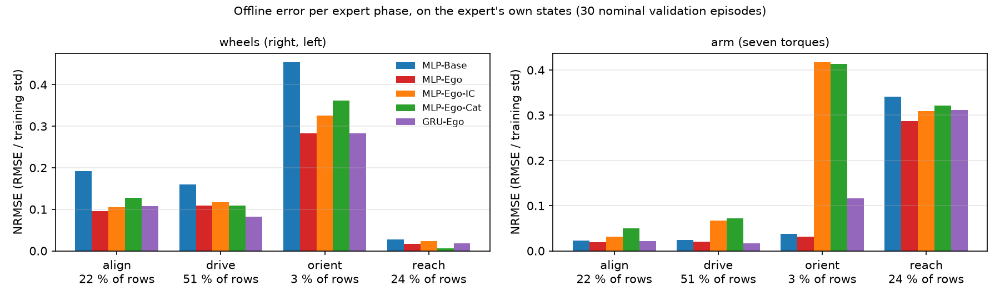
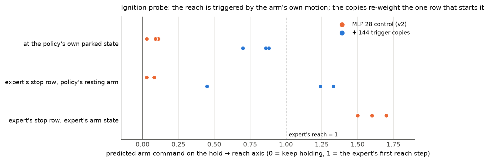

# 5. The arm that never starts, and the ignition copies

The first of the two coupled failures of the reaching policies, and the fix that turns MLP-Ego (2 of 205 arrivals within
1 cm) into MLP-Ego-IC (189 of 205). All numbers: nominal validation bank (205 held-out targets), five seeds unless marked;
tables in [results.md](results.md).

## 5.1 The symptom: the base arrives, the arm stays at home

With the egocentric inputs (MLP-Ego) the base drives to the expert's dock as well as the expert, but the arm does not
reach: the end effector stops about 20 cm from the target, which is exactly where the expert's hand is when its base has
parked and *before* its arm starts. The arm leaves its home posture (largest joint excursion > 0.1 rad) in 6 / 1 / 1 of
205 episodes (seeds 0 / 1 / 2), against 205 for the expert.

*End-effector distance to the target over time (left; median and interquartile range, three seeds pooled), its closest
approach during the episode (centre) and its value at 40 s (right). MLP-Ego (blue) plateaus at ~0.2 m; every model with
the ignition copies reaches 3–5 mm (93–95 % of episodes within 1 cm at the closest approach), the expert ~1 mm.*

## 5.2 Offline, every model copies every phase

The failure is invisible offline. On the expert's own states every model reproduces the commands of every phase,
including the start of the reach:

*One validation episode, open loop: the expert's command (black) and each model's prediction from the expert's state.
Background: the expert's phase (align, drive, orient, reach), read from its diagnostics, never a model input.*

*Normalised error per expert phase (RMSE / training std; 30 nominal validation episodes, seed 0). The reach phase is the
hardest for the arm for every model; the only large difference is the arm error of the ignition-copy models in the
orient phase, which is the deliberate cost of the copies (5.4).*

So the problem is not the fit. It is a state the policy reaches in closed loop and the demonstrations almost never show.

## 5.3 Mechanism: the reach is only demonstrated with an arm already moving

The expert's arm starts reaching the instant its navigation finishes, and its joints exceed 0.05 rad/s within the same
millisecond. In the data, the combination *arm at rest at home + base parked + label = reach* therefore exists for
**one row per episode** (3 221 rows out of 35.8 M, one in ~11 000), while *arm at rest at home + label = hold* fills the
align, drive and orient phases (76 % of the rows). A stateless regressor learns "hold when the arm is still, reach when
it is moving": a loop with no ignition. When the policy parks its base, its arm is still, so it keeps holding.

Probe (offline swap test, `scripts/analysis/arm_switch_probe.py` of the experiment records): the arm output is projected
on the hold → reach axis (0 = the hold torque, 1 = the expert's first reach torque).

| input given to MLP-Ego (no copies), seeds 0 / 1 / 2 | arm output on the hold → reach axis |
|---|---|
| the expert's own row at the instant navigation finishes | +1.5 to +1.7 (reaches) |
| the same row with the policy's resting arm state | +0.03 to +0.08 (holds) |
| the policy's own parked state in closed loop | +0.03 to +0.11 (holds) |

Only the arm state changes the answer, and within it the joint velocities. Telling the policy that the base has stopped
does not help: the trigger is the arm's own motion. (Without any fix, the policy's arm sometimes starts because the
base creeps and jostles it: that is the only ignition MLP-Ego ever gets, and why the two failures are coupled; see
[06_base_drift.md](06_base_drift.md).)

## 5.4 The fix: ignition copies (MLP-Ego-IC)

Add copies of the one row that starts the reach, so it weighs in the loss as much as its importance in closed loop:

- **trigger row**: in each training episode, the first row of the terminal run of *exactly zero* wheel labels: the
  instant the base has stopped and the reach torque starts. It is found from the **labels only** (no expert phase, no
  navigation flag is read), so the policy still learns from observations and commands alone.
- **K = 144 copies** of that row, features and labels as recorded, with Gaussian noise added to the **seven arm-velocity
  inputs only**: σ = per-joint standard deviation of the arm velocities over the rows where the base moves (0.085, 0.048,
  0.035, … rad/s), so the copies cover "arm at rest" with the jitter a resting arm has in closed loop. The normalisation
  is computed from the recorded rows, before the copies are added.
- option `trigger_copies=144` of `src/robot_learning/learning/mlp.py` (`trigger_rows`, `trigger_copies`).

**Effect**: the probe at the policy's own parked state moves from +0.03–0.11 to +0.70–0.88 (figure above); the arm
leaves home in 203–205 of 205 episodes; stable arrivals within 1 cm go from 2.0 ± 1.6 to **189.0 ± 9.3** (random-start
bank: 1.4 → 192.6).

**Choice of K** (seed 0, stable arrivals within 1 cm, nominal / random start; offline NRMSE):

| K | 0 | 16 | 144 | 512 |
|---|---|---|---|---|
| nominal 1 cm | 1 | 102 | 199 | 200 |
| random start 1 cm | 1 | 101 | 200 | 202 |
| offline NRMSE | 0.119 | 0.137 | 0.139 | 0.154 |

K = 144 is the smallest value at which the closed loop saturates; 512 gives the same arrivals with a worse fit (single
seed: 144 vs 512 is not resolved, 16 vs 144 is).

**The copies need the egocentric inputs.** MLP-Base (the 21 raw inputs + clock) with the same 144 copies reaches 15 of
205 within 1 cm (seed 0): the arm can now start, but without the target in the robot's frame the base does not park
where the reach can succeed.

**Cost.** The offline error rises (0.120 → 0.138), almost entirely in the arm outputs during the orient phase (0.03 →
0.41, phase figure): the copies teach "start reaching when the arm is at rest and the base is (nearly) parked", and
orient rows look like that. Offline this is a mistake; in closed loop it is exactly the behaviour that was missing. It
is one more instance of the report's main observation: the offline error is not a proxy for closed-loop success.

## 5.5 Memory as the alternative

A recurrent policy can carry "the base has been still for a while" in its state and start the arm without copies.
GRU-Ego (no copies) starts the arm in 170 / 200 / 205 episodes (seeds 0 / 1 / 2) and reaches 1 cm in 149 ± 24 (five
seeds); the transformer starts it in 109–174 (patience-20 version, three seeds) and TF-Ego reaches 1 cm in 158 ± 43. Memory solves the ignition partly and unreliably (the seed spread is 3–5 times the MLP's), and the
copies on a stateless MLP remain the most reliable fix.

## 5.6 What remains: holding

The copies start the arm; they do not make the arm *stay*. After reaching 3–5 mm the error of every policy grows during
the remaining seconds (left panel of the first figure: at 40 s only 25–31 % of the MLP-Ego-IC episodes are still within
1 cm), because the base keeps creeping under the arm. That is the second failure, [06_base_drift.md](06_base_drift.md).
