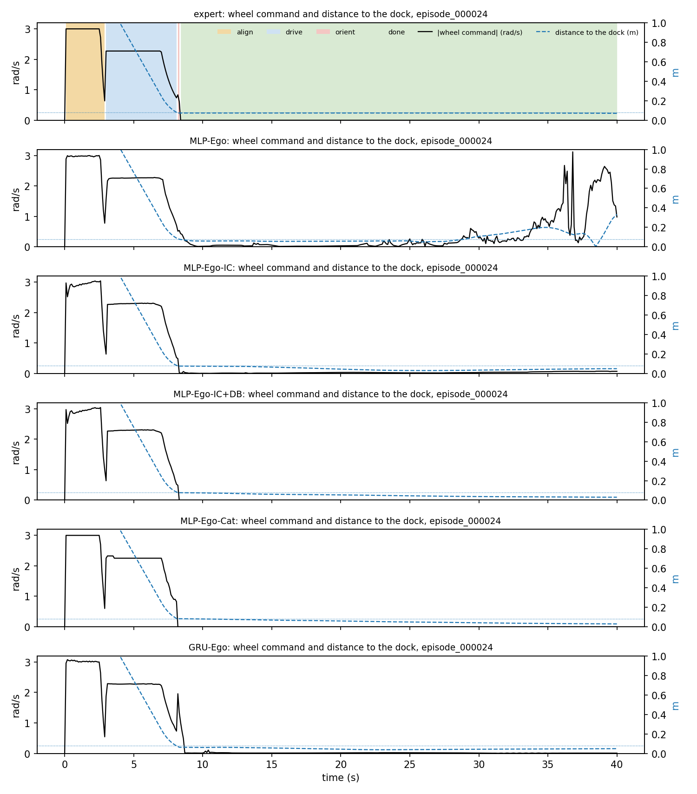
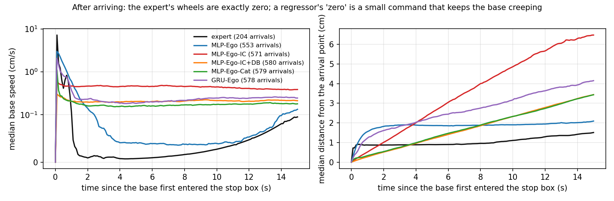
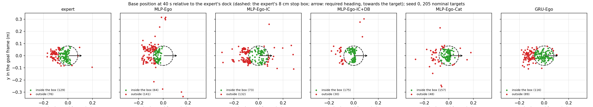
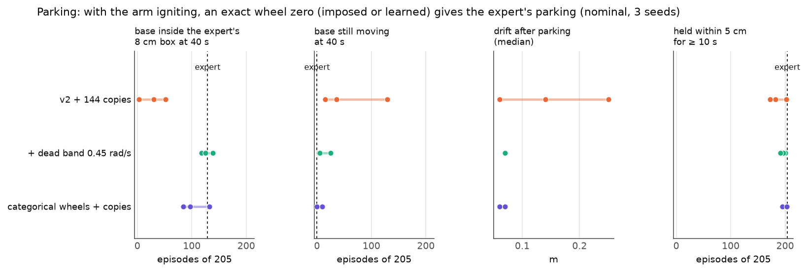

# 6. Base drift: a regressor never outputs an exact zero

The second of the two coupled failures of the reaching policies, the parking remedies (wheel dead band, categorical
wheels, memory), and why the arm-igniting MLP tolerates the drift it cannot remove. Nominal validation bank (205
held-out targets); tables in [results.md](results.md).

## 6.1 The symptom: park, creep, restart

When the expert's navigation finishes, its wheel command is **exactly zero** and stays zero (a latched state of its
controller); its base only moves by the reaction of its own arm (~1 cm). A regression network has no latch: its "zero"
is a small command, so the base keeps creeping after parking, and without an arm to finish the task the policy
eventually drives off again.

*One episode in time: wheel command (black) and distance to the expert's dock (blue dashed; dotted: the 8 cm stop box).
The expert stops at exactly zero (background: its phases). MLP-Ego parks at the same moment, creeps for ~20 s with a
small non-zero command and then restarts and leaves the dock. The models with the ignition copies stay; with the dead
band (+DB) and the categorical wheels (Cat) the command is exactly zero, as the expert's.*

*All episodes (three seeds), aligned at the first entry into the stop box. Left: median base speed (symlog scale): the
expert drops to ~0.01 cm/s within 2 s; MLP-Ego-IC keeps ~0.4 cm/s; +DB, Cat and GRU ~0.2 cm/s. Right: median distance
from the arrival point: 15 s after arriving the expert has moved 1.5 cm (arm reaction), MLP-Ego-IC 6.5 cm, GRU 4.1 cm,
+DB and Cat 3.4 cm. MLP-Ego creeps ~2 cm and restarts later (outside this window).*

*Where the base is at 40 s, in the expert's goal frame (seed 0). The expert parks on the near edge of its 8 cm box,
coming from the start, and stays there (129 of 205 inside the box at 40 s, the rest just behind its edge). MLP-Ego ends
inside in 64 (many drove off); MLP-Ego-IC in 73 (spread around the dock by the creep); +DB in 175; Cat in 157; GRU in 116.*

## 6.2 Mechanism

- **The conditional mean near the dock is not zero.** Around the dock the demonstrations mix two labels for similar
  states: exactly zero (the expert has latched *done*, possibly nudged by the DART noise) and the small orient command
  (the final turn, still running). On the nominal DART data, states near the dock with a bearing error between 0.05 and
  0.5 rad carry label 0 in 60 % of the rows and a turn of ~0.48 rad/s in 40 %. A squared-error regressor predicts the
  average: a small turn that never stops.
- **The residual integrates.** A command of a few percent of the driving command moves the base centimetres in seconds;
  the base leaves the demonstrated parked states, where the network has seen nothing but "orient" and "drive", and the
  clock keeps growing: the policy extrapolates to driving again (the restart of MLP-Ego).
- **Coupled with the arm.** The arm starts only when its own state moves (chapter 5), and the creeping base is what
  jostles it. Without the ignition copies the arm almost never starts, so nothing ends the episode's task while the base
  drifts away. With the copies the arm starts at the moment of parking and reaches while the base creeps slowly: the
  base "parks because the arm moves".

## 6.3 Why MLP-Ego-IC succeeds with the drift still there

MLP-Ego-IC keeps the residual (0.4 cm/s, 6.5 cm in 15 s), yet reaches 1 cm in 92 % of the episodes, because the **arm
compensates** the moving base: with DART noise on the wheels during the reach, the demonstrations contain thousands of
rows of the expert's arm tracking the target while its base is being pushed (the base moves faster than 1 cm/s in 83 % of
the reach rows of the nominal data), and the policy learned that compensation. What the residual still costs is the
**hold**: the base keeps moving and the end effector drifts away again after reaching (at 40 s only 25 % of the episodes
are within 1 cm, [05_arm_ignition.md](05_arm_ignition.md), first figure). The same mechanism, without the DART noise in
the hold, broke the static-obstacle task ([07_static_obstacle.md](07_static_obstacle.md)).

## 6.4 Making the zero exact

Two ways, both effective **only once the arm starts** (with a sleeping arm an exact zero just stands the base still with
the arm at home):

| remedy | how | where |
|---|---|---|
| **dead band (+DB)** | at evaluation, when both wheel commands are below 0.45 rad/s in magnitude, all four are set to exactly 0 (the expert's latched stop). A declared part of the policy, not a change of the network | evaluator option `wheel_dead_band_rad_s` |
| **categorical wheels (MLP-Ego-Cat)** | each wheel is a classifier over 41 velocity bins (−3.1 … 3.1 rad/s, one bin exactly 0), trained with cross-entropy and decoded by the most probable bin: the network picks the mode of the labels instead of their mean, so "zero" can win exactly | training option `wheel_output=categorical` |

Three seeds, nominal bank (from the experiment records):

| | base inside the expert's box at 40 s | base still moving at 40 s | drift after parking (median) | held within 5 cm for ≥ 10 s |
|---|---|---|---|---|
| expert | 129 | 0 | — | 204 |
| MLP-Ego-IC | 30 / 3 / 52 | 15 / 129 / 36 | 0.06 / 0.25 / 0.14 m | 202 / 182 / 172 |
| MLP-Ego-IC + DB | 139 / 118 / 125 | 3 / 25 / 5 | 0.07 m | 200 / 197 / 191 |
| MLP-Ego-Cat | 97 / 84 / 132 | 1 / 10 / 1 | 0.06–0.07 m | 194 / 195 / 203 |

(Box here = the expert's own stop test, position and heading.)

Both give the expert's parking (inside the box as often as the expert, no longer moving at 40 s) without costing
arrivals: 1 cm 189.2 ± 9.3 (+DB) and 188.2 ± 11.3 (Cat) against 189.0 ± 9.3. Their costs: the band is a threshold on the
output (it must be declared as part of the policy); the categorical head chatters between small bins of opposite sign
at the end of the approach (two seeds lose ~20 arrivals at 1 cm) and quantises the commands to 0.156 rad/s steps.

## 6.5 Memory

GRU-Ego stops creeping without any device (0.2 cm/s after arrival, like the exact-zero models): its state carries
"parked". It loses elsewhere (ignition and seed spread, chapter 5) and reaches 1 cm in 149 ± 24.

## 6.6 Summary for the report

The base drift is not solved by forcing a zero but by two things together: start the arm (ignition copies, or memory),
and demonstrate a perturbed base during the reach (DART), so the arm learns to compensate what is left. An exact zero
(dead band or categorical wheels) then gives the expert's parking and steadier holds without changing the arrival rate;
in the static-obstacle task, where the final turn matters more, the dead band hurt (80 → 47 % success).
