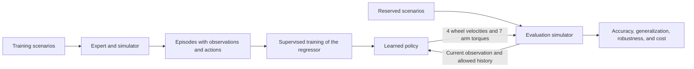

# Research Plan — COMP0245: Behaviour Cloning for a Mobile Manipulator

**Project authorship:** Rodrigo and team. **Date of plan and bibliographic review:** October 16, 2026. **Current status as of 25/10/2026:** P1 closed in the nominal test bench; P2 closed as exploratory pilot after baselines and autonomous diagnosis; causal confirmation and isolation pending. **Work branch:** `rodrigo`.

This document defines a broad research program. The scope may be adjusted later, while preserving the key questions and controls necessary for interpreting results. Phases are ordered by scientific dependencies, without imposing a current implementation timeline.

**Objective:** Train a machine learning regressor via *behaviour cloning* (BC) to produce wheel velocities and arm torques from the robot's state and a target position; measure its accuracy, generalization, robustness, and efficiency. The central question is **what combination of data coverage, observable information, and temporal memory enables reliable imitation of an expert and achievement of new objectives, and at what computational cost**.

The dataset sizes, architectures, perturbations, and experimental thresholds proposed here are **initial decisions made by us**, except when explicitly attributed to slides or code. They must be calibrated during the pilot phase and frozen prior to confirmatory experiments. No expected results should be presented as achieved results.

**Execution tracking:** the [research log](RESEARCH_LOG.md) connects phases E00–E12/P0–P7, protocol adaptations, results, and evidence. OLS and MLP have already been trained on a development split of 51/13 from the pilot of 64 scenarios; subsequently, 39 autonomous rollouts were executed: expert achieved 13/13, OLS and MLP achieved 0/13 in stable arrival. No final test is conducted. [Autonomous evaluator and limits](AUTONOMOUS_EVALUATION.md). This plan maintains its proposals as broad as such: not all are implemented.

**Expert audit, 25/10/2026:** the pilot has 62 successful terminations `success` and two `stalled`, but **64/64 final errors and stopping decisions <1 cm**. Stalling detection precedes success in the professor's code. The two `stalled` cases should not be described as unachieved; distinguish label, geometric error, and stable arrival. Details and evidence are in R08 of the log.

**Reading Guide:** Sections 1–5 establish the problem and hypotheses; 6–9 design data and models; 10–13 define how to evaluate results; 14–19 organize execution, report, and references.

<details>
<summary>Outline of the plan</summary>

- [1. Assignment and grading accountability](#1-assignment-contract-and-traceability-to-grading)
- [2. Mathematical formulation and expert interpretation](#2-mathematical-formulation-and-meaning-of-expert)
- [3. Code audit](#3-audit-of-the-code-that-conditions-the-experiments)
- [4. Bibliographic foundation](#4-bibliography-foundation-relevance-and-limits-of-transfer)
- [5. Hypotheses](#5-questions-hypotheses-and-possible-refutations)
- [6. Data design](#6-data-methodology-quantity-quality-and-coverage)
- [7. Inputs and sensors](#7-inputs-and-sensors-what-exists-and-what-we-must-validate)
- [8. Time and Fourier](#8-a-moment-temporal-windows-and-fourier)
- [9. Architectures and training](#9-regressor-architectures-and-training)
- [10. Accuracy and generalization](#10-evaluation-accuracy-and-generalization)
- [11. Robustness](#11-robustness-and-recovery-learning)
- [12. Efficiency](#12-efficiency-and-performance-frontier)
- [13. Experiment matrix](#13-experiment-matrix-and-controls)
- [14. Reproducibility](#14-experimental-engineering-and-reproducibility)
- [15. Phases](#15-execution-phases-and-criteria-for-progression)
- [16. Report](#16-figures-tables-and-scientific-narrative-of-the-report)
- [17. Open questions](#17-uncertainties-and-pending-decisions)
- [18. References](#18-annotated-bibliography-and-sources--)
- [19. Glossary](#19-glossary-for-discussing-the-project)

</details>

## 1. Assignment contract and traceability to grading

Primary source: [COMP0245 Assignment 2026/27 Slides](COMP0245-Assignment-2026-2.pdf). The following numbers count the cover page as slide 1.

| Slides | What the professor establishes | Evidence we will produce |
|---|---|---|
| 2–4: objective and outline | BC supervised from expert trajectories; reproduce the task and generalize to new objectives and/or initial conditions | Dataset of observation-action pairs; regressor; autonomous executions with reserved objectives and initial conditions |
| 4: interface | Base inputs: `base_pos`, `base_bearing`, `q_mes`, `qd_mes`, `TARGET_EE_POS`; output: `wheel_cmds`, `torque_arm`; extra information exploration is allowed | Explicit baseline with those inputs; ablations that add information without silently changing the task |
| 4–5: methodology | Generate data; design evaluation; justify data quantity/quality, inputs, time instant versus time interval, architecture, training, and hyperparameters | Sampling protocol, learning curves, dataset audit, controlled comparisons, and decision logging |
| 6: accuracy | Evaluate how accurate the solution is | Action error and goal-reaching metrics, distinguishing offline evaluation from simulation control |
| 6: generalization | Evaluate other objectives and initial conditions | Separate tests for interpolation, reserved regions, extrapolation, and new initial configurations |
| 6: robustness | Evaluate adversities | Degradation curves under noise, delay, and defined physical perturbations |
| 6: efficiency | Memory, number of parameters, and computation time | Inference memory, parameters, latencies, and control period compliance |
| 7: milestones | Briefing on 20/10; in-person demonstration between 30/10 and 06/11, mandatory though not graded; submission on 06/11 | Reproducible demo; report and code. Dates are as specified in this PDF |
| 8–10: deliverables | IEEE LaTeX report of maximum 6 pages; contributions of maximum 1 page, possibly page 7; README with execution instructions, outputs, sources, and modifications | Report consistent with experiments; verified instructions; code attribution; contribution declaration |
| 10: delivery files | No need to include data or weights/checkpoints in Moodle; GitHub link is allowed if code exceeds the limit | Regeneration procedure and manifest files; access to artifacts when necessary |
| 11–14: grading | Methodological correctness, understanding, reproducibility, justification, and interpretation; novel ideas well-utilized for higher scores | Reproducible results, failure analysis, and a defensible experimental contribution |

The rubric describes 0–49 as work that is largely incomplete or contains fundamental flaws; 50–59 with important methodological issues, inadequate use of resources, or insufficient justification; 60–69 with generally correct methodology but technical or reproducibility limitations; 70–79 with very minor errors, excellent documentation, and clear understanding; 80–100 adds well-justified novel ideas in the method or validation. **The number of models tested by itself does not constitute a contribution.**

The requested formulation is supervised regression of continuous actions. The trunk of the project will be BC. DAgger is studied as an extension of interactive imitation, and generative models are considered extensions of BC; they must be clearly identified and compared in a clean manner against the base regressor. Reinforcement learning, language models, and object manipulation are not required in these slides.

## 2. Mathematical formulation and meaning of "expert"

The expert is the programmed controller from the instructor: phase-based navigation of the base and arm control via differential inverse kinematics, PD control, and gravity compensation. Along a trajectory, it observes the robot and emits actions at each step.

We define the minimal observation according to the slide schema:

$$o_t = [p^b_t,\ \psi_t,\ q^a_t,\ \dot q^a_t,\ g],$$

where $p^b_t\in\mathbb{R}^3$ is the base position, $\psi_t$ its planar orientation, $q^a_t,\dot q^a_t\in\mathbb{R}^7$ the arm positions and velocities, and $g\in\mathbb{R}^3$ the Cartesian target. These are **21 scalars**; representing bearing with sine and cosine yields 22.

The required output is:

$$a_t = [\omega^{FR}_t,\omega^{FL}_t,\omega^{BL}_t,\omega^{BR}_t,\tau^1_t,\ldots,\tau^7_t]\in\mathbb{R}^{11}.$$

The wheels receive speed commands in rad/s and the arm receives torque commands in N·m. Fingers are kept in their fixed configuration, as in the base code. **Predicting joint velocities of the arm or desired positions would alter the output interface**; any study of such a variant must be separated from the main result.



The dataset contains complete episodes $D=\{\tau_i\}$ and expert pairs $(o_t,a_t^E)$. We train $\hat a_t=f_\theta(o_t)$ or $\hat a_t=f_\theta(o_{t-H+1:t})$ with a supervised loss. During autonomous evaluation, the model's actions change the robot's next state; thus, a small error in the dataset can accumulate during execution. This sequential dependency motivates closed-loop evaluation and potential extension with DAgger. [Ross et al., 2011](https://proceedings.mlr.press/v15/ross11a.html).

**The expert's memory matters.** Their action also depends on an internal state $h^E_t$: navigation phase, accumulated arm reference, maintained initial posture, and execution time. Formally, $a_t^E=\pi_E(s_t,g,h_t^E)$. The minimal observation may not capture all this information. Similar observations having different labels could indicate insufficient observability, as well as possible recording errors. A short window also does not guarantee full history recovery.

## 3. Audit of the code that conditions the experiments

Versions inspected: instructor starter `cae4fb69386872ae73c601ce77e182aad7abe284`; local project `c8c1bfb42d5d3c6c1760df4543461685ba8bf6fb`; RoboEnv `7bb49439677c2ac111347b40e997025ce87bff50`; submodule `simulation_and_control` `df5850526affcc33b25b15d3096c4d21b614bacd`. The inspection was static and no simulation has been yet validated. The RoboEnv checkout shows unversioned content within its submodule; hashes alone will not suffice to reproduce that environment.

Sources: [episode motor](../src/robot_learning/simulation/episode.py), [controllers](../src/robot_learning/expert/controllers.py), [execution instructions](SIMULATOR.md). For local inspections: [PyBullet interface of RoboEnv](../../RoboEnv/simulation_and_control/simulation_and_control/sim/pybullet_robot_interface.py) and [Robotnik configuration](../../RoboEnv/configs/robotnik_arm.json). These last two links require the local folder structure; for the team, repository, commit, and environment changes will also be recorded.

**Technical update of 23/10/2026:** A brief startup run without GUI has been verified. The script now directly passes the RoboEnv root to `SimInterface` and `PinWrapper`, using `ROBOENV_ROOT` or the sibling checkout as the default path. Local links to assets have been removed; expert control laws remain unchanged. This startup verification does not replace objective and trajectory validation. The task README contains adapted instructions.

Local configuration can be saved in `.env`, ignored by Git, with a versionable template `.env.example`. A loader based on the standard library reads it before configuring the GUI and step limit; terminal variables take precedence and sibling checkout detection is preserved. Record the effective values of these options in each experiment, without relying on a personal `.env` file to reproduce results.

| Finding | Methodological Consequence |
|---|---|
| `q_mes` and `qd_mes` from the script contain 17 joints: 4 wheels, 7 arm joints, and 6 fingers; the arm is `[4:11]` | Store complete arrays with names, but define a baseline of 21 variables using the 7 arm joints. The interpretation of slides and real dimensions must remain explicit |
| `base_controller` maintains the phases `align`, `drive`, `orient` and a separate `done` indicator | Measure errors per phase; store phase for analysis. Do not deliver it freely to a policy that we intend to be autonomous |
| `arm_controller` integrates `q_des_arm` and maintains `q_init_arm` while navigating | Compare memory and access to the initial posture; do not use expert references as normal inputs |
| The desired base orientation is calculated from `atan2(target_y, target_x)`, referenced to the world origin | Do not assume that translating or rotating an episode produces equivalent labels. Audit displaced initial conditions and compare absolute and relative representations |
| The expert has a navigation timeout of 25 s and a software arm-reach rule of 0.85 m | An expert failure does not demonstrate physical impossibility; it could reflect a limitation in strategy or available time |
| Arrival tolerance set to 0.01 m, minimum temporal duration of 8 s, and stopping due to stagnation | Record the original criterion; additionally define a common external evaluation that does not depend on the expert's internal phase |
| Local configuration with `time_step=0.001` and default maximum of 40,000 steps | Nominal physical frequency of 1 kHz and approximate horizon of 40 s. Confirm real-time loop timing; distinguish physical frequency, control frequency, sampling rate, and history rate |
| Current logging is used for plots only and does not directly save a complete dataset of expert actions | Record observation and action before `sim.Step`; record next state after. Also save the last step, currently at risk of being lost when the loop breaks |
| Measurements used for stopping checks occur before the `sim.Step` of that iteration | Explicitly align timestamps and terminal states to avoid a one-step offset in metrics |
| Expert commands pair right and left wheels | Ablation with two independent wheel speeds expanded to four outputs, versus four independent outputs |
| `GetMotorTorques` returns `applied_motor_commands` | This is a command applied by the actuator layer, not evidence of an independent physical torque sensor |
| `motor_accelerations` and the plural buffer key are stored, but `GetMotorAccelerationTMinusOne` reads singular names | Visible inconsistency upon inspection; validate/correct with traceability or compute causal differences outside the getter before using acceleration |
| Some getters introduce noise on every call; `*_cov` fields are passed as `scale` to `np.random.normal` | The value is used as standard deviation in those calls. Use one coherent observation per time step and verify units; avoid adding different noise to each read of the same signal |
| The body linear velocity getter contains `self.self.bot` in the noise branch | Validate that path before using it; an explicit rotation of world velocities is a verifiable alternative |
| `collision_enable=0` disables the URDF self-collision option in this implementation | Do not interpret absence of recorded contacts as absence of self-intersection. Audit geometry before asserting movement safety |

The wheel controller continues converting requested velocities into actuator actions. Maintaining this common layer for expert and model forms part of the provided interface; replacing the two high-level controllers does not eliminate all low-level physics or control.

**Repository scope:** `week1/` and `week2/` are excluded, as these are independent lab exercises that are not imported by the final-project code. The `src/robot_learning/` starter depends on its local controller and external libraries, including RoboEnv's `simulation_and_control`. Labs remain available upstream and in history; their removal does not alter the expert of the final task.

## 4. Bibliography: foundation, relevance, and limits of transfer

The review combines fundamentals with recent works available up to the date of consultation. It is a targeted selection addressing the assignment questions, not a systematic exhaustive review nor a claim of having the most recent model in the field. Improvements published in other tasks are not demonstrated to be effective on this robot.

| Work | Contribution that guides this plan | Limitation of extrapolation |
|---|---|---|
| [Ross et al., DAgger, 2011](https://proceedings.mlr.press/v15/ross11a.html) | Distribution shift caused by the policy's actions; iterative collection of corrections | Our expert has temporal memory and must be carefully defined on how to consult it outside of its trajectories |
| [Mandlekar et al., CoRL 2021 / proceedings 2022](https://proceedings.mlr.press/v164/mandlekar22a.html) | Recurrent BC, demonstration quality, observation selection, and difficulty in selecting checkpoints by offline loss | Human demonstrations and manipulation tasks do not determine how many trajectories Robotnik needs |
| [Lin et al., 2024; revision v4 June 2026](https://arxiv.org/abs/2410.18647v4) | Studies demonstration diversity and volume; motivates separating coverage of conditions and repetition | Visual diversity of objects/environments is different from diversity of goals and states; this application is our hypothesis |
| [Dass et al., DataMIL, 2025; revision v2 June 2026](https://arxiv.org/abs/2505.09603v2) | Selecting data based on its utility for performance can be better than indiscriminately accumulating data | Their large dataset mixtures are different from our generated data; we will first use simple selection controls |
| [Laskey et al., DART, 2017](https://proceedings.mlr.press/v78/laskey17a.html) | Demonstrations with perturbations and recovery to expand coverage | Adding arbitrary noise does not equate to implementing a full DART |
| [Bai et al., 2018](https://arxiv.org/abs/1803.01271) | Temporal convolutions as an alternative to recurrence | General sequence comparison, not direct evidence regarding this controller |
| [Zhao et al., ACT, 2023](https://arxiv.org/abs/2304.13705) | Predicting action sequences using transformers | Action chunks from other interfaces do not guarantee stability when applying arm torques in open-loop |
| [Chi et al., Diffusion Policy, 2023/2024](https://arxiv.org/abs/2303.04137) | Generative BC of actions and control with receding horizon | The ability to represent multimodality may not compensate for its cost in a low-dimensional deterministic expert |
| [Wang et al., OneDP, ICML 2025](https://proceedings.mlr.press/v267/wang25ba.html) | Distillation of a diffusion policy to reduce generation steps | Accelerating the generative model does not guarantee adherence to our control period |
| [Pertsch et al., FAST, 2025](https://arxiv.org/abs/2501.09747) | Action sequences represented via cosine transform | FAST tokenizes actions for VLAs; it does not demonstrate that a FFT of our observations improves regression |
| [Tancik et al., NeurIPS 2020](https://arxiv.org/abs/2006.10739) | Fourier features for coordinate function regression | Input encoding and temporal spectral analysis are distinct interventions |
| [Agarwal et al., NeurIPS 2021](https://arxiv.org/abs/2108.13264) | Importance of uncertainty and careful aggregation when comparing algorithms | We adapt statistical evaluation principles, without assuming this project is RL |
| [Shi et al., FODMP, preprint of March 2026](https://arxiv.org/abs/2603.24806) | Recent work on fast generation and temporal structure of movements | Exploratory reference; we consulted its abstract. It is not a proposed implementation as baseline nor a validated result on Robotnik |

A plausible contribution of the project would be to demonstrate, with controls, when a short-term memory or additional velocities substitutes part of the information missing in an instantaneous observation, and how this effect changes when the demonstration coverage is expanded. The novelty would be contextual and experimental; no claim is made of inventing a globally new algorithm.

## 5. Questions, hypotheses, and possible refutations

| ID | Hypothesis to test | Primary comparison | What would weaken the hypothesis |
|---|---|---|---|
| H1 | Given a comparable data budget, covering more targets and initial states improves generalization more than repeating few conditions | High diversity versus high repetition; equal number of episodes and additional analysis with equal number of transitions | Small or inverted differences when controlling for architecture, duration, and seeds |
| H2 | Base inputs and wheel velocities provide useful dynamic information, especially during slipping | Base inputs versus base + wheel velocities | No improvement in autonomous control, or benefit disappears with time windows |
| H3 | Memory helps imitate an expert with phases and internal references | MLP instantaneous, MLP with window, TCN and GRU; comparable parameter budget | No reproducible improvement, or improvement only appears when giving the model more temporal capacity |
| H4 | Accelerations and past actions help under certain conditions, but can increase sensitivity to noise | Add each group separately and cross with noise/latency | Gain only with ideal signals or when future information is accidentally used |
| H5 | Causal spectral features can summarize useful dynamics with lower cost than a full window | Raw window, simple temporal summaries, FFT/DCT with equal history | Do not outperform simple summaries, lose phase information, or worsen transitions |
| H6 | Compact models can approximate the success of large models with lower latency and memory | Capacity–success–cost curves and architecture comparisons | Cost reduction implies significant losses in success or robustness |
| H7 | Recovery demonstrations reduce failures arising from deviating from the dataset | BC nominal versus BC with recovery; DAgger as extension | Gain explained only by more samples or expert assistance during evaluation |

Each experiment will record hypothesis, intervention, controlled variables, primary metric, interpretation criterion, and possible failures **before looking at the final test results**. Hypotheses can be rejected; a well-explained negative result is useful.

## 6. Data methodology: quantity, quality, and coverage

**Update of 23/10/2026:** the current pilot proposal is uniform sampling within a box, with a fixed nominal initial pose; its proposed limits and new experiments are in [Pending Notes and Experiments](EXPERIMENT_NOTES.md). The alternative based on sectors/radii from the following section is retained as initial proposal. Its ranges and radial G2 examples must be revisited in light of the box support before finalizing the splits.

### 6.1 Expert pilot and domain definition

First, validate nominal execution with the original target `[0.0, 1.1, 0.5]`, without altering gains, physics, or strategy. Record the actual environment used and verify joint order, signs, units, limits, and timestamps.

Then propose a pilot of **64 conditions**: 8 angular sectors × 4 radii × 2 heights, with nominal posture. As an initial exploration domain, consider horizontal radius relative to origin between 0.6 and 1.4 m and height between 0.3 and 0.8 m. These ranges are not demonstrated workspaces: they must be reviewed by the expert and geometric checks. Include front, back, and both sides; do not concentrate all demonstrations near the original target pose.

Expand the pilot with variations of initial state: planar displacement up to ±0.15 m, yaw up to ±15°, arm joint angles up to ±0.1 rad relative to nominal posture, and zero initial velocities. Check limits, absence of interpenetration, and initial transient behavior. Later, also vary initial velocities and larger disturbances. Treat as distinct conditions combinations of target and posture; the pilot is used for development, not as a final test.

Classify each execution into: arrival, timeout, stagnation, joint limit, forbidden contact, numerical instability, or another identified failure. **"The expert failed" and "the target is physically unachievable" are distinct statements.** The original function may print that the target is unachievable by observing stagnation; that message is not a geometric proof.

Freeze two evaluation sets: one of qualified conditions in which the expert reaches the target, and another broader stress set. Retain failures and the rejection rate of qualification to ensure the declared domain is transparent. Never remove a case from the test because the model fails.

### 6.2 Sampling design

Represent each scenario by `scenario_id` and a vector of factors: target, initial base pose, initial arm posture/velocity, physical parameters, and perturbation seed. Also store the sampling measure: uniform sampling in radius does not equate to uniform sampling in area. If uniformity in an annular region is desired, sample $r=\sqrt{u(r_{max}^2-r_{min}^2)+r_{min}^2}$, with $u$ uniformly distributed, and angle uniformly distributed.

Compare random sampling with stratified sampling by sector, radius, and height; use Latin hypercube or Sobol as candidates to cover continuous factors. Do not assert full space coverage simply because these methods are used: show histograms, occupied cells, and distances to nearest neighbors in the training set. Any distance must be defined using physical scales or normalized training scales, not mixed units without a clear criterion.

For H1, construct conditions with equal budget: for example, 512 episodes distributed among 512 diverse targets/initial poses versus 64 conditions with 8 runs each. In a deterministic simulator, repeating exactly the same condition may produce duplicates: identify and report such cases. To study repetition with variability, explicitly introduce small perturbations or different seeds, while keeping the same center of each condition.

Separate two comparisons: same number of episodes and same number of transitions used in training. Long trajectories should not automatically gain more weight nor be confused with greater diversity. Add a comparable computational budget analysis to avoid attributing performance gains to the dataset due to more optimization steps.

### 6.3 How much data: an evidence-based decision

Use nested training sets of **32, 64, 128, 256, 512, 1,024, 2,048, and 4,096 episodes**, expandable if further improvement remains significant. These are proposed points for a curve, not a claim that 4,096 is necessary. Separate these episodes into validation and testing sets. Construct at least three stratified selection orders to verify that a favorable curve does not depend on a lucky subset.

For each size, measure validation success, Cartesian error, coverage, subgroup errors, and seed dispersion. Initially compare a MLP and a temporal model to avoid declaring "sufficient data" simply because a limited architecture has reached its ceiling. Fit a saturation curve or power law only if the data and residuals support it; do not extrapolate it as a guarantee.

**Proposed sufficiency operational criterion:** after two duplications, the estimated improvement in success rate is less than 2 percentage points and the confidence interval for the improvement is sufficiently narrow to rule out a meaningful gain; no significant coverage gaps or degradation of difficult cases remain. Two percentage points is a practical threshold to record prior to analysis. If the interval is wide, the result is inconclusive: expand the evaluation or revise the design. Also consider reduction in final error, even if binary success has stabilized.

The bibliographic justification is methodological. Mandlekar et al. study dataset fractions and show task difficulty dependence. Lin et al. separate diversity and repetition, observing diminishing returns in their tasks. This supports **measuring our curve**, not copying their number of demonstrations. [Mandlekar et al.](https://proceedings.mlr.press/v164/mandlekar22a.html), [Lin et al.](https://arxiv.org/abs/2410.18647v4).

Always report: collection attempts, valid episodes, successful episodes, distinct conditions, simulated seconds, stored transitions, sampled transitions for training, and disk space used. A 40-second trajectory at 1 kHz has approximately 40,000 steps, but not 40,000 independent behavioral examples.

### 6.4 Quality and selection

Apply integrity checks first: finite values, monotonically increasing timestamps, aligned lengths, known bounds, joint names, applied actions, and termination reasons. Store raw data and an acceptance/rejection manifest; do not overwrite them with filtered versions.

Quality will be described through several metrics: success, final error, time, command saturation, phase transitions, contacts, stability, and coverage. A slow demonstration may contain valuable recovery episodes. A fast demonstration is not necessarily better for teaching stability.

Compare four compositions, controlling for size and coverage:

| Dataset | Composition | Question |
|--------|-------------|----------|
| Q0 | Valid and successful expert episodes | Clean reference |
| Q1 | Q0 with phase balance or explicit weighting | Does avoiding dominant repetitive segments help? |
| Q2 | Q0 plus successful recoveries from perturbations during demonstration | Can we learn to correct deviations? |
| Q3 | Controlled mixture of valid but failed or suboptimal episodes; proposed proportions 10%, 25%, 50% | When do additional data help and when do they degrade BC? |

Phase balancing only uses training metadata; also report loss with the natural distribution and autonomous performance. Record whether inverse weights are used to correct sampling or whether the training objective is deliberately changed. Temporal windows maintain their continuity even if their end point is stratified sampling.

Uncertainty-based, coverage-based, or validation failure selection will be an extension with a dedicated validation set. Compare with random selection of the same size. DataMIL motivates evaluating utility for performance, but our heuristic should not be called an implementation of DataMIL. [Dass et al.](https://arxiv.org/abs/2505.09603v2)

### 6.5 Frequency, redundancy, and storage

Initially preserve logs at physical frequency to audit alignment. Select training points with temporal subsampling, conserving sufficient examples of startup, stopping, and phase transitions. Analyze autocorrelation within each episode and action change distribution. The effective number of temporal observations can be used as a diagnostic, not as a substitute for the number of independent scenarios.

Separate four decisions:

1. **Physical integration:** currently 1 ms in local configuration.  
2. **Action update:** initially every step; reducing it requires a new experiment with actions held between updates.  
3. **Training example selection:** can be dispersed without reducing control frequency.  
4. **History sampling:** defined windows in seconds, possibly with more spaced steps.

Subsampling a continuous signal for spectral analysis requires considering aliasing; apply causal filtering when appropriate and document the delay. If the control frequency is changed, collect and validate labels consistent with that regime. A held torque for 10 ms may behave differently than one updated every 1 ms.

Candidate format: HDF5 by episode or compressed NumPy files with a JSON/CSV manifest. Choose based on access to windows and measured size; store floats with documented precision and do not physically duplicate all overlapping windows. File names and formats are proposed, not yet an implemented API.

| Group | Minimum fields |
|---|---|
| Identity | `episode_id`, `scenario_id`, `parent_episode_id` if derivatives exist, seed, split, hashes of code/config/dataset |
| Condition | Target, initial pose, initial velocities, physics, perturbations, and evaluation result |
| Time | `step`, `t`, `dt`, observation instant and action application instant |
| State | Base, full orientation, complete q/qd with names; additional observations available |
| Actions | `expert_wheel_cmds`, `expert_torque_arm`, actual action sent and saturations; origin of the action |
| Diagnostics | True EE, errors, expert phase, internal references, contacts and limits; fields separated from allowed inputs |
| Final | Success according to protocol, termination reason, number of steps, integrity, and exclusion cause if any |

### 6.6 Splits and information leakage prevention

Assign scenarios to splits **before generating windows, normalizing, or applying data augmentation**. All versions of an episode, duplicated trajectories, derived recoveries, and windows belong to the same split. If a set is defined by a reserved target, all repetitions of that target remain within it; for target+pose, additionally record which factors share support with training.

Propose 256 validation conditions, stratified, and independent test suites defined in Section 10. If robustness is tuned using perturbed validation, use distinct seeds and conditions from those used in testing. The pilot set is marked as development and is not recycled as a confirmatory evaluation.

Compute normalization, feature selection, adjusted filters, and Fourier parameters using only training data. Hyperparameters and checkpoints are selected via validation. Testing is used only after freezing decisions; new ideas arising from observing the test go into exploratory phases or require a new confirmatory dataset.

Do not augment targets by changing only `TARGET_EE_POS`: the expert action would change. Do not rotate or translate state-action pairs without demonstrating controller and dynamics symmetry. Do not construct windows centered on future. Valid transformations are applied per episode and preserve traceability.

## 7. Inputs and sensors: what exists and what we must validate

Saving many signals for diagnosis does not imply feeding all of them to the model. Training information must have an equivalent available when executing the policy.

| Group | Signal and origin | Hypothesis and necessary control |
|---|---|---|
| F0: baseline | `base_pos`, `base_bearing`, `q_mes[4:11]`, `qd_mes[4:11]`, target | 21 variables; repeat with sine/cosine of bearing. Preserve the literal reference to the schema |
| F1: geometry | Target relative to the base; optionally rotated to the base frame | May facilitate learning; compare adding it and replacing coordinates. The expert is not automatically invariant to origin |
| F2: base velocities | `GetBaseLinVelocity`, `GetBaseAngVelocity`; planar or body frame projection | Distinguish being stationary from sliding. Measure cost and noise; validate frame transformations |
| F3: wheels | `qd_mes[:4]` and errors between previous command and measured velocity | Information about response/slip. Accumulated absolute wheel angles could act as a spurious clock; study them separately |
| F4: joint acceleration | Causal difference `(qd_t - qd_prev)/dt`, with optional causal filter; exists getter with pending inconsistency | May reveal transients, but amplifies noise. Compare ideal derivative, noisy signal derivative, and filtered version |
| F5: base acceleration/IMU | Causal differences of linear and angular velocity; simulated orientation and gyroscope | The world acceleration is not solely a reading from an accelerometer. A simulated IMU requires explicit frame, gravity, bias, and noise |
| F6: previous actions | Last requested wheel velocities and arm torques sent by the own policy | Provides control history. When evaluating, must be the agent's own actions, not the expert's; measure training misalignment |
| F7: previous applied torque | `GetMotorTorques` read before emitting the new action, with validated timestamp | Is output from the actuator layer. For the arm, it may be nearly redundant with the previous action; do not call it an independent force measurement |
| F8: EE kinematics | Position and EE error computed with Pinocchio from measurements | Provides geometric knowledge, not necessarily new information. Account for FK cost; use measurements consistent with noise, not hidden ground truth |
| F9: initial state/clock | Recorded initial posture, elapsed time or step | Available, but may introduce duration dependence. Compare with memory and test different delays/velocities |
| F10: contacts/forces | Query contact forces in PyBullet; force/torque sensors only after valid joint configurations are set | Can assist with physical interaction. The file includes foot names: verify their relevance to Robotnik; do not assume sensors are operational |
| F11: perception | RGB/depth camera or virtual rays added via simulator APIs | Justify only if introducing uncertainty in localization or obstacles. With exact state and target, cost can be added without resolving a real limitation |
| O: privileged information | Expert phase state, `q_des_arm`, `qd_des_arm`, current expert action | Only diagnostic/oracular. Current actions are labels, never inputs to the regressor that predicts them |

In real robotics, joint positions would correspond to encoders, velocities could be derived or estimated, and base pose would require localization/odometry. Here we start with simulation state. Compare simulation truth, degraded signal, and estimator, without presenting a perfect signal as a realistic sensor.

For each group of inputs, add it **separately** to a frozen baseline. Then combine groups that provide reproducible improvements. If F8 is added, derive it from the observation received by the model: using the true simulator state under noise could artificially remove the difficulty.

Expert labels can be computed from clean state during a noisy observation experiment, if it is declared that one learns to act correctly from imperfect observations. This differs from imitating an expert who also sees noise. Evaluate both definitions separately when relevant; in neither case is the label provided to the model as a feature.

## 8. A moment, temporal windows and Fourier

### 8.1 Temporal protocol

Compare instantaneous state; concatenation of past observations; causal TCN; GRU/LSTM with memory. Define the time history in physical time: propose **20, 100, 250, and 500 ms** windows, with 1 s extension for long phases. Choose sampling resolution with the pilot; "20 samples" covers durations different from 1 kHz and 100 Hz.

Each window ends at the decision instant. For episode beginnings, use padding with the first observation and a mask, or a defined initial state; apply the same rule during training and inference. Windows never cross resets. In GRU/LSTM, reset memory at the start of an episode and define burn-in for training on fragments. Train with hidden states always zero in intermediate fragments and evaluate with continuous memory may introduce another mismatch.

Compare finite memory and recurrent memory under similar parameters. A GRU that processes the entire episode has access to more history than a 100 ms window: explicitly state this, or add a recurrent controller reset with the same history. If the policy requires the initial posture, also compare F9; more recent samples do not necessarily recover it.

Separate **observation history** from **action horizon**. Using past information can maintain a reactive decision at each step. Predicting a block of future actions introduces another decision: how many actions to execute before observing again.

### 8.2 Fourier-based experiments with concrete meaning

The Fourier proposal breaks down into three independent lines:

1. **Exploratory analysis:** compute spectrum/PSD of velocities, accelerations, and torques from demonstrations during training, phase by phase. Identify oscillations, time scales, and noise-associated content. This guides window selection and sampling; it does not itself prove that spectral features are beneficial.
2. **Spectral features of the history:** compute real FFT or DCT over a past window of known length and frequency. Use only a few coefficients or energy per band combined with the current state. Compare with simple statistics—mean, standard deviation, and temporal differences—on the same window.
3. **Fourier features of coordinates:** encode normalized positions using selected sine/cosine frequencies, trained on training/validation data. This changes the spatial representation and must be evaluated in a separate experiment. [Tancik et al.](https://arxiv.org/abs/2006.10739).

For line 2: remove the mean when appropriate, document the Hann window or another, sampling frequency, and bands; compute only with data available up to $t$. The spectral resolution is approximately $1/T_w$, and the Nyquist limit is $f_s/2$: a 100 ms window cannot accurately resolve a 1 Hz phenomenon. Magnitude alone loses phase and temporal order; compare real/imaginary coefficients or signed DCT and preserve the current observation. Reach movements are transient and need not be periodic.

An additional compression experiment can predict DCT coefficients of a block of **future actions** and reconstruct it. This is learning of a future output, so those actions can be labeled during training, but are never inputs when executing. Keep the final result within the 11 continuous actions required and evaluate reconstruction error and stability. FAST uses DCT to tokenize sequences in VLAs; we take this as inspiration, without asserting that we implement FAST. [Pertsch et al.](https://arxiv.org/abs/2501.09747).

**Decisive control:** identical window availability, comparable dimensions/capacity, and preprocessing cost included. If an FFT improves over the current state but not over a raw window, the evidence favors temporal history over spectral transformation.

## 9. Regressor architectures and training

**Decision implemented on 25/10/2026:** first baseline OLS (unregularized linear regression), 21 inputs and 9 outputs: right/left + 7 arm torques; reconstruct the 4 wheels via `[right, left, left, right]`. The original dataset retains 11 commands. Split by episodes 51/13, normalization applied only during training, comparison with mean, and offline metrics per channel/group/episode. See [pipeline and results](BASELINE_TRAINING.md).  
An MLP 128×128 was implemented subsequently with the same split: [protocol and result](MLP_BASELINE.md). Ridge follows the same trend. The first autonomous evaluation follows in [closed-loop results](AUTONOMOUS_EVALUATION.md). Sine/cosine encoding and other variants from the plan are not yet applied to the 21-input baseline.

### 9.1 Model family and function of each comparison

All learned baselines receive allowed observations and produce continuous actions. First, ensure that units, normalization, and control loop function correctly; then increase capacity.

| Model | Proposed Initial Configuration | What It Allows to Study |
|---|---|---|
| E | Original expert evaluated by the same evaluator | Performance and cost reference; not a mathematical upper bound |
| B0 | Mean-action predictor | Offline sanity check. No need to physically execute it in each comparison |
| B1 | Multitask Ridge regression | How much a regularized linear model explains |
| B2 | Extra Trees / random forest multitask | Non-neural baseline for low-dimensional states; measure discontinuity, cost, and extrapolation |
| B3 | MLP with 2 hidden layers of 128 units, ReLU, linear output of 9 | Primary neural baseline, with variants of 64/128/256 units and 2/3 layers |
| B4 | MLP with flattened window | Effect of observing history without a specialized temporal architecture |
| B5 | Causal TCN with residual blocks and dilations | Finite history with temporal structure; record actual receptive field |
| B6 | GRU, 1–2 layers, hidden state 64/128; LSTM as alternative | Episode memory and expert transition dynamics |
| B7 | Shared trunk with wheel and torque heads; alternative: separate networks | Interference between two subsystems with different scales and dynamics |
| B8 | Phase-predicted conditional regressor with specialized heads | Learned hierarchical structure; report phase and regression errors. The true phase remains as a diagnostic oracle |
| B9 | Small temporal transformer or block-inspired ACT predictor | Longer dependencies and future actions; control history, parameters, and executed horizon |
| B10 | GMM/mixture of experts or state-conditioned Diffusion Policy | Residual multimodality, only if it persists after correcting observability and data |
| B11 | Compression/distillation of a competent policy, including a OneDP-inspired variant | Precision–cost frontier; also count the cost of training the teacher |

The initial choice of the 2×128 MLP serves as a reproducible reference point. With 21 inputs and 9 outputs, it has 20,489 parameters if all layers are dense with bias. The final count will be determined by the constructed model, as additional heads and inputs alter the total.

B5 is based on the temporal model comparison by Bai et al.; B6 relies on the recurrent BC interest shown by Mandlekar et al. These are candidates, not a guaranteed expectation of superiority. [Bai et al.](https://arxiv.org/abs/1803.01271), [Mandlekar et al.](https://proceedings.mlr.press/v164/mandlekar22a.html).

ACT and Diffusion Policy extend the contemporary menu of BC. For this controller, their adoption requires evidence of a specific limitation in the regressor: memory, multimodality, or temporal coordination. The ambiguity arising from hiding the expert's state is not necessarily resolved by a more complex generator. Compare deterministic and stochastic actions with recorded inference seeds. [Zhao et al.](https://arxiv.org/abs/2304.13705), [Chi et al.](https://arxiv.org/abs/2303.04137).

### 9.2 Normalization and losses

Normalize inputs with training statistics; handle constant columns without division by zero. Use sine/cosine for bearing and study a periodic encoding of joints where physical sense exists. Do not indiscriminately wrap joints with mechanical limits.

The outputs mix rad/s and N·m. Use a group-wise loss with scales $s_j$ obtained from training, with a minimum for nearly constant channels:

$$L_{BC}=\frac{\lambda_w}{2}\sum_{j\in W}\left(\frac{\hat a_j-a^E_j}{s_j}\right)^2+\frac{\lambda_\tau}{7}\sum_{j\in A}\left(\frac{\hat a_j-a^E_j}{s_j}\right)^2.$$

Starting point: $\lambda_w=\lambda_\tau=1$. Compare normalized MSE with Huber; study phase-weighting only as an explicit intervention. Always report MAE/RMSE in physical units. Compare statistical normalization with physical reference scales if unequal variance causes small channels to dominate the loss.

Smoothness regularization requires consecutive real samples, not paired samples from a shuffled batch. Penalizing absolute variation may erase legitimate phase transitions; an alternative is to penalize the difference between predicted action increments and expert increments. Evaluate its effect on latency, error, and recovery, without assuming that a smoother command is better.

### 9.3 Output constraints

Maintain the torque limit of ±30 N·m from the controller as an initial reference, subject to verifying the robot's actual limits. Wheel velocities must have a documented limit derived from the interface/expert, not from the minimum and maximum observed in a small subset. Store raw action, clipped action, and saturation frequency; measure how much work the limiter performs.

Compare four free-velocity configurations with two left/right expanded outputs at the original order. The second design incorporates a verified expert structure; it should not be hidden as mere parameter reduction. Maintain seven arm torques in both variants.

Any filter, variation limiter, or correction layer is part of the evaluated system and must be counted in the cost. If analytical gravity compensation is combined with learned residual torque, label it as **hybrid variant** and compare it with the total torque regressor; do not attribute to the model any computation performed by the physical component. During the main test, there will be no silent substitution of expert actions.

### 9.4 Optimization, Selection, and Comparability

Proposed neural search: AdamW; learning rate logarithmically varying between `1e-5` and `3e-3`; weight decay between `0` and `1e-3`; batch size of 128/256/512 samples or windows; early stopping; gradient clipping for recurrent models; explicit seeds. These values are candidates for validation, not known optimal hyperparameters. Ridge and trees will have their own comparable searches in terms of effort, not a single unfavorable configuration.

Use random or Bayesian search with a declared trial budget per family. Distinguish two questions: "best performance with equal search budget" and "performance with equivalent computational resources". Record number of updates, samples seen, training time, and checkpoint evaluation policy. With datasets of different sizes, compare convergence and control over constant updates; a fixed number of epochs does not equate to equivalent computation.

Select checkpoints using a fixed set of **validation** rollouts and a recorded rule: first success, then lower final error, and if practically equivalent, lower cost. Offline loss serves as an additional diagnostic. To avoid selection based on noise, use the same number of evaluations per method and confirm finalists on a separate, distinct validation set; testing remains closed.

For main conclusions, at least **5 training seeds**, expandable to 10 if differences are small or variability is high. These are design objectives, not automatic guarantees of statistical power. Publish all seeds and runs, not just the best one.

## 10. Evaluation: accuracy and generalization

### 10.1 Separate offline prediction from autonomous execution

Offline evaluation uses reserved expert trajectory observations to compare actions. Closed-loop evaluation restarts the simulator in each scenario and allows the model to operate with its own observations, previous actions, and memory. Do not step-through expert states and call it autonomous control.

| Level | Metric | Definition and purpose |
|---|---|---|
| Offline | MAE and RMSE per output | Error relative to each expert velocity/torque in its units; macro average per joint and per group |
| Offline | Normalized error | Facilitates comparison across scales; normalizers fixed during training |
| Offline | Error per phase and transition | Detects if the hidden mean fails during turning, braking, or starting to reach a target |
| Closed-loop, primary | Success rate `SR_1cm` | Fraction of episodes with distance EE–target ≤1 cm during a defined duration, within the horizon |
| Closed-loop | `SR_2cm`, `SR_5cm` and success–tolerance curve | Sensitivity to threshold; 2 and 5 cm are proposed diagnostics, not substitutes for the primary threshold |
| Closed-loop | Final and minimum distance | Terminal error and best approximation; report both to distinguish fleeting arrival from stability |
| Closed-loop | Integrated error | $\frac{1}{T}\int_0^T\|p^{EE}_t-g\|_2dt$, with common horizon for comparison |
| Closed-loop | Time to success | Physical time until first stable arrival period; failures are censored or explicitly penalized |
| Closed-loop | Arrival stability | Drift and variation of EE during a maintenance window |
| Closed-loop | Actuator usage | Frequency of saturation, peaks, normalized total variation, and limit violations |
| Closed-loop | Execution failures | NaN, divergence, timeout, defined contacts, or invalid terminal condition |

**Proposed definition of success:** distance ≤ 1 cm during 0.5 s prior to a 40 s horizon, without invalid termination. The centimeter comes from the expert-configured tolerance; the duration is our decision and must be calibrated and frozen. Additionally, report a arrival metric consistent with the original logic to distinguish the effect of the new criterion. One centimeter is the criterion of the inspected code, not an explicitly numerical requirement from the slides.

The external evaluator does not depend on `base_state.done`: the learned model may not have this state. A policy that reaches the goal before 8 s must be measured correctly; the 8 s constraint belongs to the original script's stopping condition and is recorded separately. Avoid giving a policy less opportunity than another due to stagnation termination. For terminal distances and integrated error, use a common horizon; if invalid termination occurs, preserve the failure and apply a previously defined penalty rule, without filling with favorable values.

Measure the EE with true state for evaluation, regardless of the noise the policy observes. For stability after reaching the goal, continue the simulation during the defined window and verify that the controller does not merely cross the success zone by inertia.

Do not directly average wheel velocities with arm torques. Do not use $R^2$ as the primary metric in channels that are nearly constant. The integral $\int|\tau^\top\dot q|dt$ may indicate mechanical work of the arm, but it does not represent total electrical consumption nor the overall energy efficiency of the platform. Parameters and memory are distinct metrics from energy consumption.

### 10.2 Separate suites for generalization

**ID** means new conditions sampled from the same training distribution. **OOD** means factors outside the declared training support. Do not refer to a repetition with another seed as "extrapolation".

| Suite | Design | Interpretation |
|---|---|---|
| G0: ID | Objectives and conditions new within the same domain, without duplicates | Interpolation and generalization within the distribution |
| G1: reserved regions | Complete sectors/volumes of objectives excluded from training; explicit separation boundary | Spatial generalization to unseen gaps; not necessarily outside the global envelope |
| G2: objectives out of range | Radii or heights outside the training ranges, pre-qualified by the expert | Extrapolation. Initial proposals: radius 1.4–1.8 m or height 0.8–1.05 m, subject to pilot input |
| G3: new initial conditions | Objectives ID with base poses, yaw, and arm postures outside training ranges | Generalization of initial state, isolated from the objective |
| G4: new combinations | Individual factors individually seen, but certain objective–posture combinations reserved | Compositional generalization |
| G5: combined change | Objectives and initial states OOD occurring simultaneously | Joint stress; does not allow attributing failure to a single factor |

Publish the domain of each suite, scenario manifest, distribution of distances/heights, and results by sector. For G3, vary one factor at a time before combining them. Objectives that are unattainable or difficult for the expert may form a separate stress suite; they do not contaminate a successful imitation claim in a pre-defined domain.

Evaluate the expert on exactly the same scenarios and report `SR_modelo`, `SR_experto`, and absolute difference. Report results on the full set and on the pre-defined qualified subset; never filter by model success. If the expert fails outside the distribution, discuss their limit and verify whether the model's failures align.

### 10.3 Evaluation size and statistical inference

For a fixed policy and independent Bernoulli scenarios, a conservative approximation of the sample size needed to estimate a rate with half-width $\epsilon$ at 95% confidence is:

$$n\approx\frac{1.96^2\,0.25}{\epsilon^2}.$$

This yields approximately 97 scenarios for ±10 percentage points, 196 for ±7, and 385 for ±5. **This is precision for a proportion, not power to detect differences between models nor for generalization across training seeds.** Use Wilson intervals for a policy's success rate; sample size approximations are reviewed with the pilot and sampling dependence.

Confirmatory proposal: **400 scenarios per main suite**, evaluated using the same 5 seeds for each finalist; smaller sets for validation filtering. Do not treat 2,000 rollouts as 2,000 fully independent observations if they share 400 scenarios and 5 trained policies.

Use paired scenarios and perturbations across models; report success differences and error differences with 95% confidence intervals. For method comparisons, resample training seeds and scenarios at their respective levels, preserving pairing and grouping derived scenarios by family. If all seeds are tested across all scenarios, the design is cross-validated: do not apply a row bootstrap that ignores this structure. For a single fixed pair of policies, McNemar can complement the paired binary comparison.

For final error: median, interquartile range, and mean with interval; show distribution and tails. For success: percentage with numerator/denominator. For time: success accompanied by time between successes, plus a probability curve of having reached the target before time $t$, or a time penalized by horizon. A policy that only solves easy cases should not appear faster by excluding its failures.

Predefine primary comparisons, for example B3 versus the best temporal model and F0 versus F0+velocities. For families of confirmatory comparisons, apply adjustments such as Holm and report effect sizes. Numerous exploratory ablations are presented as such. A p-value does not substitute practical relevance nor uncertainty intervals. The emphasis on uncertainty is motivated by [Agarwal et al.](https://arxiv.org/abs/2108.13264); the concrete statistical design of this project is our adaptation.

## 11. Robustness and recovery learning

### 11.1 Controlled perturbations

Apply one difficulty at a time, followed by justified combinations. Freeze models before testing. Use exactly the same scenario perturbation when comparing expert and models; distinguish observation noise, action perturbation, and physics change.

| Factor | Initial levels for calibration | What is recorded |
|---|---|---|
| Position noise | Deviation 0 / 1 / 5 / 10 mm | Instantaneous noise versus fixed bias per episode; separate base, target, and derived EE |
| Angular noise | Deviation 0 / 0.1 / 0.5 / 1 degree, converted to radians | Apply valid orientation; do not perturb quaternions without normalization |
| Velocity noise | Physically determined scales via pilot, and as secondary analysis 1% / 5% / 10% of training scale | Effect on velocities and derivatives; declare the definition of scale |
| Observation delay | 0 / 1 / 5 / 10 / 20 ms | Causal buffer, buffer start, and timestamps |
| Observation loss | Probability 0 / 1% / 5% / 10%, in addition to bursts | Keep last observation, mask, and age; same strategy for all |
| Friction | Multipliers 0.5 / 0.75 / 1 / 1.25 of nominal | Floor and wheel friction separately; effective coefficient and slip |
| Pushes | Impulses with fixed direction, momentum, and magnitude per scenario | Calibrate impulse as mass × desired velocity change; recovery time and success rate |
| Mass/load | Multipliers 0.9 / 1 / 1.1 / 1.2 where physically coherent | Update inertias or add modeled load; declare whether the expert knows the change |
| Actuator response | Gain or command delay | Saturation, oscillation, and divergence; do not confuse with sensor noise |
| Control frequency | Candidates 1000 / 500 / 200 / 100 Hz | Physical integration maintained; sustained actions and expert/model compatibility |

The ranges above are for the pilot, not guaranteed hardware tolerances. Record units and mechanism for each perturbation. The native noise configuration may also affect the internal wheel servo because it queries getters; for an experiment of noise only in the policy, use an explicit observation layer that does not alter the physics or the servo.

Metrics: success and error versus intensity, absolute drop relative to nominal, worst subgroup, and area under the robustness curve with declared normalization. Do not sum curves with different units into a single number without defining their weights. Test perturbation during navigation and during reaching separately; pushing after `done` may reveal that the expert does not reactivate the base.

### 11.2 Acquired robustness versus incidental robustness

Compare nominal training with training that includes noise/physics variation and with recovery demonstrations. The levels observed during training and the levels held in reserve must be declared. Also evaluate nominal performance to detect whether robustness is gained at the expense of precision.

In data collection with action perturbation: consult the expert's clean corrective action in the current state, save that label, and apply a perturbed, controlled action to explore; in the next state, the expert re-decides. Distinguish expert label from executed action. If perturbation distribution is not optimized as in DART, call the method **BC with perturbed demonstrations**, inspired by DART. [Laskey et al.](https://proceedings.mlr.press/v78/laskey17a.html).

### 11.3 DAgger as an interactive supervised extension

Train initial BC; execute the policy in training scenarios; consult the expert in visited states; add observation–correction pairs; retrain. Count additional episodes and queries and compare with BC that receives the same budget of new demonstrations. Do not use test scenarios for data collection.

The expert has mutable state: define one instance per episode, initialized with the real condition and updated only once per observed step, even if its action is not executed. Save phase, time, and internal reference with each query. A second call for logging may mutate the phase or integrate the arm reference twice, altering the labels. Verify that corrections are valid in distant states and record when the expert does not know how to recover. DAgger does not automatically transform this expert into an optimal recovery controller. [Ross et al.](https://proceedings.mlr.press/v15/ross11a.html).

## 12. Efficiency and performance frontier

Measure **decision time**, **physical time until arrival**, and **training time** separately. A fast inference may generate slow or imprecise movements.

| Measurement | Protocol |
|---|---|
| Parameters | Trainable and total counts; in trees add nodes/deepth/size, without equating them to neural weights |
| Weight Size | Bytes in checkpoint and numerical precision; a dense FP32 requires approximately 4 bytes per parameter just for weights |
| Runtime Memory | Peak and steady-state process/model memory, temporary buffers and activations; separate CPU and GPU |
| Model Latency | Batch 1, warm-up, thousands of calls, median/p95/p99; CPU first, then GPU separately |
| End-to-End Latency | Reading/processing, FK if used, windows/FFT, transfers, inference, denormalization, and limits |
| Control Latency | Fraction of decisions exceeding `dt_control`; the ability to handle 1 kHz is not inferred from an average below 1 ms |
| Learning Cost | Data collection, training, expert search and queries; hardware, threads, precision, and versions |

Exclude rendering, plots, and log writing from the inference benchmark, but measure separately the total cost of simulation. Time both the expert and the model under the same measurement limits, conditions, and thread policies; synchronize the GPU during measurement and distinguish batch throughput from decision latency. If the EE is used only for evaluation, separate that common calculation from the policy cost; if it is an input, include it.

Build Pareto fronts: success versus p95/p99, memory and parameters, with uncertainty in success. Define a practically tolerable loss, for example 2 points of success, before declaring a model "equivalent but more efficient"; verify it using confidence intervals or pre-specified non-inferiority tests, not by absence of statistical significance.

Explore width reduction, distillation, reduced precision, or quantization after establishing a competitive model. Each compressed version requires new closed-loop executions: small numerical errors may affect stability. OneDP shows a recent direction for accelerating generative policies; its published frequencies do not transfer to our task. [Wang et al.](https://proceedings.mlr.press/v267/wang25ba.html)

## 13. Experiment Matrix and Controls

The order avoids attributing performance improvements to an architecture when they actually stem from dataset correction or added information. Extensions are kept in the broad plan and activated only when the question is well-posed.

| ID | Experiment | Control held fixed | Main outcome | Dependency |
|---|---|---|---|---|
| E00 | Expert evaluation, signals, and evaluator | Nominal starter and frozen versions | Expert success map and temporal audit | Start |
| E01 | Mean, Ridge, trees, and MLP with F0 | Same episodes, splits, and interface | Offline baseline and autonomous success | E00 |
| E02 | Curves from 32 to 4096 episodes | Fixed validation; MLP and temporal reference | Gain when doubling dataset size, with uncertainty | E01 |
| E03 | Diversity versus repetition | Matched episode counts; additional control for transitions/computation | Generalization G0–G4 | E01 |
| E04 | Quality and recovery Q0–Q3 | Size/coverage and budget recorded | Nominal success and robustness | E01 |
| E05 | Inputs F1–F9, added individually | Base data and model frozen | Benefit of each group, ideal and with noise | E01 |
| E06 | Instant, windows, TCN, GRU | Inputs, historical duration, and capacity comparable when applicable | Gain attributable to memory | E01, phase audit |
| E07 | Raw window, simple summaries, FFT/DCT | Same history and included cost | Temporal information versus spectral transformation | E06 |
| E08 | Heads, separate networks, and wheel symmetry | Data/inputs and computation comparable | Coordination and cost of structure | E01 |
| E09 | Final size and architecture | Search budget and common selection rules | Success frontier—latency—memory | E02, E05, E06 |
| E10 | Nominal robustness versus perturbed training | Paired test conditions and perturbations | Curves by severity and nominal cost | E04, E09 |
| E11 | BC + random collection versus DAgger | Equal query budget/additional data | Recovery and distribution shift | E09, validated expert off-trajectory |
| E12 | Spatial Fourier features or action spectral representation | Fixed representation baseline and action horizon | Specific contribution of representation | E07 or E09, depending on variant |
| E13 | ACT inspired, GMM/diffusion and distillation | Same interface, information, test and declared budget | Does additional complexity resolve an observed failure? | E09, memory diagnosis/multimodality |
| E14 | Confirmatory evaluation of finalists | Frozen decisions, all seeds and suites | Results for the report | E09–E13 based on final scope |

First perform ablations of a single factor. Then study specific interactions using a small factorial design: **memory × extra wheel velocities**, **acceleration × noise**, and **coverage × capacity**. The improvement from combining two interventions does not prove that both are necessary; include each individually and perform an ablation of elimination from the final combination.

Models that receive expert phases or internal references are labeled as diagnostic oracles. A hybrid controller, a model with FK, and one that only uses raw state belong to distinct information configurations. Show these differences alongside their results and costs.

## 14. Experimental engineering and reproducibility

**Initial implementation date: 23/10/2026:** there is a [data collection pipeline](DATA_COLLECTION.md) executable via `scripts/collect_dataset.py`, with JSON specifications, independent episodes, transition logging, effective configuration, provenance, and restart capability. Both modes use `simulation/episode.py`: it applies the action and then evaluates `check_stop` using the pre-step time/error measurement, following the original professor's sequence; it still does not include the confirmatory evaluator with 0.5 s persistence. The directories in the next section remain a planned structure for the full system.

### 14.1 Code structure and planned evolution

The current code is unified under `src/robot_learning/`, with launchers in `scripts/`. The [architecture guide](ARCHITECTURE.md) documents expert provenance and functional preservation. The tree below distinguishes implemented components from future extensions; future directories have not yet been created:

```text
docs/RESEARCH_PLAN.md       # this protocol
experiment_specs/                 # scenarios, sweeps, inputs and evaluation rules
src/robot_learning/settings.py    # shared configuration implemented
src/robot_learning/expert/        # expert controllers
src/robot_learning/simulation/    # episode engine, rules, setup and interactive interface
src/robot_learning/data/          # scenarios, collection, schema and storage
scripts/                          # small simulation and collection commands
tests/                            # behavior integrity and regression tests
datasets/                         # local data, excluded from Git
src/robot_learning/learning/      # future: representations, regressors and training
src/robot_learning/evaluation/    # future: suites, robustness and benchmarks
checkpoints/                      # future: weights, excluded from Git
results/                          # future: compact metrics and figures
report/                           # future: IEEE LaTeX and contributions
```

Maintain identifiable origin of the expert and describe modifications; the original code can be refactored without changing its behavior. The initial refactor preserves exactly the 32 matrices recorded in a complete reference trajectory of 8,001 transitions, and passes regression tests. These checks do not demonstrate exhaustive equivalence across all states. For the environment, use the root of RoboEnv to resolve `configs/` and `models/`, according to local instructions, rather than creating divergent copies of assets. Record versions and hashes of URDF/configs, local modifications, libraries, and hardware. An upstream update produces a new experimental version if the expert, physics, or task changes; do not mix datasets without identifying them.

### 14.2 Simulation Step Contract

```text
1. Read a coherent observation and mark time t.
2. Construct inputs exclusively using information available up to t.
3. Consult the expert once if appropriate to collect a label.
4. Choose the executed action: expert, student, or predefined perturbation.
5. Save observation, label, raw action, and applied action with their origins.
6. Advance the physics according to the control period.
7. Read the new state and update external and terminal metrics.
8. Save the transition and final state even if the episode terminates.
   In expert data collection, the stopping decision uses the measure of 1 after applying the action, as in the starter. Distinguish its metrics from the physical state after step 7; do not introduce a second strict limit.
```

Student test: the expert does not generate backup actions. A separate expert trajectory can be executed from the same reset for comparison. The evaluator has access to the simulation truth; the policy only receives declared inputs.

### 14.3 Checks that validate the methodology

- Verify name/index correspondence, signs, and units match those of an inspected episode; confirm that the label precedes the transition that triggers it.
- Replay a saved trajectory using recorded actions and compare its evolution within defined tolerances; document whether the simulation is not bit-to-bit deterministic.
- Check resets, seeds, absence of recurrent states or inherited expert references across episodes and simulation client closure.
- Detect duplicates and relationships between episodes; verify that no splits or time windows cross resets.
- Compare calculated acceleration with known differences and timestamps; validate noise/delay branch before large-scale data collection.
- Verify that normalizers and temporal extraction produce the same results during training and execution using an identical prefix.
- Test causality invariants: modifying data after time t should not change the input or prediction at time t.
- Validate metrics using simple trajectories: brief entry into the success zone, dwell time, timeout, and numerical failure.
- Confirm that the previous actions used by the student are the student's own, and that there is no accidental access to phase, expert reference, or current expert action.
- Replay a result from a clean checkout using identified configuration, dataset, and checkpoint.

These checks are designed to address real risks; no extensive infrastructure is required before validating the first episode.

### 14.4 Execution logging

Save `run_id`, commit, and local diff, specification hash, dataset/split, data/train/evaluation seed, inputs, architecture, hyperparameters, search budget, selected checkpoint, hardware, and metrics per episode. Derive tables and figures from these files via scripts; avoid manually copying numbers.

A decision log must include: question, alternative considered, validation evidence, decision, and limitation. Record negative results, failed executions, and protocol changes. Team contributions will be documented during work on tasks, experiments, and reviews; the number of commits alone does not measure scientific contribution.

## 15. Execution phases and criteria for progression

| Phase | Work | Output Evidence |
|---|---|---|
| P0: contract and expert | Understand controller, interface, assets, and success criteria | Audited nominal episode and list of assumptions; pilot domain described |
| P1: experimental bank | Reset, scenarios, logging, and external evaluator | Reproduction of trajectories and causal/alignment tests passed |
| P2: pilot data and BC | Small dataset, splits, Ridge/MLP | Initial learning curves and first autonomous executions; failures classified |
| P3: data and information | Quantity/quality/coverage and input groups | Evidence of what improves performance and why; versioned data |
| P4: memory and representation | Windows, recurrence, TCN and Fourier | Comparisons distinguishing history, capacity, and representation |
| P5: robustness and cost | Perturbations, recovery, and Pareto | Degradation curves, memory, parameters, and full latency curves |
| P6: foundational extensions | DAgger, hierarchy, generative or compression based on observed failure | Additional value over baselines with stated budget and observations |
| P7: confirmation and communication | Freeze final candidates, run suites, and write | Tables with intervals, reproducible figures, demo, report, and contributions |

If P2 fails, diagnose first: synchronization, normalization, joint ordering, coverage, unobserved internal state, and action deployment. A low offline loss together with autonomous failure requires inspecting trajectories and visited distribution. Increasing network size is not an explanation for the failure.

This plan preserves the full program requested. The subsequent selection of experiments for delivery must preserve a baseline, causal controls, separate validation, and coverage of the four evaluation axes, even if some extensions are reduced.

## 16. Figures, tables, and scientific narrative of the report

The final report must uphold a central claim with evidence. Candidate formulation, pending results: **the performance of BC for this manipulator is conditioned by demonstration coverage and the available temporal information, and these decisions produce measurable trade-offs between generalization, robustness, and cost**.

Desirable artifacts:

1. Expert diagram → dataset → regressor → simulation, with exact inputs and outputs.  
2. Training domain map and reserved suites, together with the expert performance map.  
3. Learning curve with uncertainty bands and diversity/repetition comparison.  
4. Ablation table of inputs and memory, including baseline and model sizes.  
5. Success/failure per generalization suite and robustness curves.  
6. Success-latency-memory frontier and analysis of representative failures selected with explicit rules.

Tentative distribution of the six report pages: 0.75 for problem and context; 2 for methodology; 2.5 for results and discussion; 0.75 for limitations, conclusion, and bibliography. Adjust to actual format, reserving space for references within the limit unless otherwise specified by the professor. The statement of contributions is separate, maximum one page.

The discussion must explain **why** a variant works or fails: phase transition errors, lack of recovery, angular coverage, dependence on initial posture, sensitivity to derivatives, or representation cost. Include relevant differences even if they do not support the initial hypothesis. A video illustrates the points; scenario-level metrics support the conclusions.

## 17. Uncertainties and pending decisions

| Question | How to resolve it |
|---|---|
| What does the course exactly mean by `q_mes`/`qd_mes` in the minimal input? | Use arm according to the slide scheme; document that the script array has 17 elements and create a variant with wheel velocities. Confirm in briefing if needed |
| What range of targets and initial conditions is reasonable? | Pilot and expert evaluation, with recording of failed attempts; do not invent a guaranteed scope |
| Is it valid for an expert action to be taken in states visited by the model? | Audit of memory and recoveries before DAgger; compare cases with irreversible phases |
| Does acceleration contribute information or mainly noise? | Causal ablation with validated derivatives and noise sweeping |
| Is there an independent torque sensor? | The inspected API delivers applied commands; any additional physical simulation measurement requires another implementation and validation |
| Does a brief history suffice to recover phases? | Comparison of windows, recurrence, and initial posture; oracle only as diagnostic |
| What control frequency is feasible? | Measure expert/model performance and stability before decimating actions |
| How do collisions and coordinate frames affect the system? | Inspect URDF and effective configuration; validate FK against simulator and autocollision if used as metric |
| Are hybrid variants, DAgger, or generative methods allowed in the main deliverable? | The slides fix supervised BC and a regressor; preserve this core and clearly present extensions. Raise the issue to briefing if it becomes the focus |
| When can a superiority over the expert be claimed? | Only within the evaluated domain, metric, and budget, with uncertainty; do not extrapolate to general superiority or real robot performance |

### 17.1 Questions for the lecturer: command limits and expert rules

Added on 25 October 2026 at Rodrigo's request. **Awaiting answers.** The
alternatives below are questions, not confirmed assignment requirements or
permission to change the expert. Bring these two topics to the next meeting.

**1. Command limits and regressor outputs**

> In autonomous evaluation, we limit commands before applying them to the
> simulator. Should we retain the software limits of the reference controller?
> Which limits represent physical robot constraints, and which are controller
> design choices? Should we apply the same external clipping to the regressor,
> require the regressor to learn to respect the limits, or compare both approaches,
> including a bounded output layer?

Context: our current evaluation limits are ±5.272727 rad/s per wheel, calculated
from the maximum linear/angular velocities, and ±30 Nm for arm torques. The wheel
bound is an envelope defined by our evaluation protocol; it is not an independent
per-wheel saturation in the lecturer's controller or a certified motor limit.
Should we use this envelope or impose joint constraints on linear/angular base
velocity? Expert wheel labels reach 3 rad/s in the pilot.

On training states, the MLP predicts torques up to 37.30 Nm; in autonomous control
it eventually requests much larger commands. Clipping limits the applied command
but does not guarantee stability. **We have not established that clipping causes
the divergence, or that a bounded output layer is necessary.** Should acceleration
limits or other actuator constraints also be represented?

**2. Configurable rules: what should be imitated, and what may vary?**

> The expert uses a 0.85 m reach rule, a standoff table and a 25 s base-navigation
> timeout. Should we keep these fixed when generating demonstrations and expect
> the regressor to reproduce their effects, including phase transitions and
> stopping? Or should we vary them in our experiments? If they vary between
> episodes, should we supply them as model inputs or train separate policies
> for each configuration?

Points to clarify:

- **0.85 m:** a geometric reach rule measured from the shoulder frame, not a
  demonstrated physical maximum of the arm. Should we preserve the expert's
  projection of an auxiliary target? The original target remains the input and
  the reference for task metrics.
- **Standoff:** desired horizontal base-to-target separation as a function of
  target height. Current heights `[.1, .5, 1.1, 1.25]` m map to distances
  `[.8, .65, .65, .35]` m. Is this a fixed strategy to imitate, or a design
  parameter we may optimize? Are we assessed on fidelity to this strategy,
  reaching the target, or both?
- **25 s timeout:** ends navigation, subsequently commands zero wheel velocities,
  and enables arm reaching; it does not end the entire episode. Must the policy
  learn this transition? May elapsed time be an input, or may an external
  supervisor implement it? Expert phase and `nav.done` are not observable inputs
  of our baseline.
- Changing these rules without informing the regressor can change labels for
  similar observations. What generalization across configurations is expected,
  and what information may the policy receive?

**Provisional approach until clarified:** preserve the current configuration and
expert, document external command limits, and declare learning, supervision and
configuration changes as separate variants. These questions do not authorize
implementing tanh outputs, new inputs, or timeout/standoff changes.

## 18. Annotated bibliography and sources  

Web query conducted on **16/10/2026**. Original papers, conference proceedings, and author websites are prioritized. arXiv versions are noted when relevant; a recent preprint does not constitute independent validation. Annotations indicate how each reference is used, not results from the project.

1. **Vasconcelos, F.; Modugno, V.** *COMP0245 Assignment — 2026/27*. [Local slides](COMP0245-Assignment-2026-2.pdf). Source of scope, questions, assessment, and deliverables. SHA-256: `c05896d589255704ecee21b1f7932a6483628aa507c2ae1a68c1ccf52aa0a8f4`.  
2. **Modugno, V.** [Public starter COMP0245](https://github.com/VModugno/LAB_SESSION_COMP_0245_2026_PUBLIC/tree/cae4fb69386872ae73c601ce77e182aad7abe284/final/robotnik_arm_task). Inspected reference code. [RoboEnv](https://github.com/VModugno/RoboEnv) and [simulation_and_control](https://github.com/VModugno/simulation_and_control) provide the environment; local versions in section 3.  
3. **Ross, S.; Gordon, G.; Bagnell, D. (2011).** *A Reduction of Imitation Learning and Structured Prediction to No-Regret Online Learning*. AISTATS, PMLR 15:627–635. [Paper and PDF](https://proceedings.mlr.press/v15/ross11a.html). Foundation of DAgger and the difference between supervised loss and sequential behavior.  
4. **Mandlekar, A. et al. (CoRL 2021; proceedings 2022).** *What Matters in Learning from Offline Human Demonstrations for Robot Manipulation*. PMLR 164:1678–1690. [Paper and PDF](https://proceedings.mlr.press/v164/mandlekar22a.html). Methodology and comparison of observations, memory, quantity/quality, and model selection were consulted.  
5. **Lin, F.; Hu, Y.; Sheng, P.; Wen, C.; You, J.; Gao, Y. (2024, revised 2026).** *Data Scaling Laws in Imitation Learning for Robotic Manipulation*. arXiv:2410.18647, v4, 26/06/2026. [Version consulted](https://arxiv.org/abs/2410.18647v4). Forms the basis of the diversity versus repetition experiment and the need to measure marginal gains.
6. **Dass, S.; Khaddaj, A.; Engstrom, L.; Madry, A.; Ilyas, A.; Martín-Martín, R. (2025, revision 2026).** *DataMIL: Selecting Data for Robot Imitation Learning with Datamodels*. arXiv:2505.09603, v2, 19/06/2026. [Version consulted](https://arxiv.org/abs/2505.09603v2). Recent reference for data selection focused on performance.  
7. **Laskey, M.; Lee, J.; Fox, R.; Dragan, A.; Goldberg, K. (2017).** *DART: Noise Injection for Robust Imitation Learning*. CoRL, PMLR 78:143–156. [Paper and PDF](https://proceedings.mlr.press/v78/laskey17a.html). Motivates collecting corrections after perturbations.  
8. **Bai, S.; Kolter, J. Z.; Koltun, V. (2018).** *An Empirical Evaluation of Generic Convolutional and Recurrent Networks for Sequence Modeling*. arXiv:1803.01271. [Paper](https://arxiv.org/abs/1803.01271). Reference for TCN versus recurrent models.  
9. **Zhao, T. Z.; Kumar, V.; Levine, S.; Finn, C. (2023).** *Learning Fine-Grained Bimanual Manipulation with Low-Cost Hardware*. RSS; arXiv:2304.13705. [Paper](https://arxiv.org/abs/2304.13705). Reference for ACT to study action blocks, maintaining interface differences with this project.  
10. **Chi, C. et al. (2023; extended version 2024).** *Diffusion Policy: Visuomotor Policy Learning via Action Diffusion*. Original work RSS 2023; arXiv:2303.04137v5 is the extended version consulted. [Paper](https://arxiv.org/abs/2303.04137v5). Reference for generative BC and receding horizon.  
11. **Wang, Z. et al. (2025).** *One-Step Diffusion Policy: Fast Visuomotor Policies via Diffusion Distillation*. ICML, PMLR 267:63399–63416. [Paper and PDF](https://proceedings.mlr.press/v267/wang25ba.html). Reference for acceleration via distillation.
12. **Pertsch, K. et al. (2025).** *FAST: Efficient Action Tokenization for Vision-Language-Action Models*. arXiv:2501.09747. [Article](https://arxiv.org/abs/2501.09747). Inspiration for spectral representation of action sequences; does not justify by itself the FFT of observations.  
13. **Tancik, M. et al. (2020).** *Fourier Features Let Networks Learn High Frequency Functions in Low Dimensional Domains*. NeurIPS 33. [Article](https://arxiv.org/abs/2006.10739). Conceptual basis for the spatial encoding ablation.  
14. **Agarwal, R.; Schwarzer, M.; Castro, P. S.; Courville, A.; Bellemare, M. G. (2021).** *Deep Reinforcement Learning at the Edge of the Statistical Precipice*. NeurIPS. [Article](https://arxiv.org/abs/2108.13264). Reference to uncertainty and evaluation with multiple runs; explicit adaptation to BC design.  
15. **Shi, X.; Ebrahimi, A.; Hu, Y.; Jin, J. (2026).** *FODMP: Fast One-Step Diffusion of Movement Primitives Generation for Time-Dependent Robot Actions*. Preprint arXiv:2603.24806, March 25, 2026. [Article](https://arxiv.org/abs/2603.24806). Recent context on speed and temporal structure; exploratory reading of the abstract, not a basis for implementation decisions.

## 19. Glossary for discussing the project

| Term | Meaning here |
|---|---|
| Expert | Teacher program that provides reference actions |
| BC / behaviour cloning | Train a supervised model on examples of what the expert observed and did |
| Regressor | Model that predicts continuous values: wheel velocities and arm torques |
| Policy | Rule that transforms observations, and possibly memory, into actions |
| Trajectory / episode | Complete execution from reset to termination |
| Rollout | Execute a policy in the simulator and observe its evolution |
| Closed loop | Re-observe the state produced by the own actions before deciding |
| Ablation | Change or remove a component to measure its contribution |
| Generalization | Performance under conditions not used during training |
| Covariate shift | Changes the distribution of observed states; in BC this can occur because the model diverges from the expert |
| Information leakage | Accidentally using future, labels, or test information to learn or decide |
| Privileged information | Signal available to the simulator or expert that is not admitted as student input |
| Parameters | Values learned by a model; hyperparameters are decisions about architecture and training |
| Pareto | Options for which one criterion cannot be improved without worsening at least one other |
| Confirmatory result | Test of a decided comparison before consulting the final evaluation set |

## Metrics tracking, update 25/10/2026

By decision of Rodrigo, the current report focuses on base and full system;  
it does not separately score arm control via relative trajectory. The  
[trajectory diagnosis](BASE_AND_SYSTEM_TRAJECTORIES.md) retains metrics for  
commands, global task, and navigation, with dense start at 1ms, first separation times, and graphs for all 13 scenarios. These observations are post-hoc development from P2, not new confirmatory scenarios nor proven causes.


### Scope update: closure of exploratory P2 (25/10/2026)

See R17 of the record: OLS/MLP and mean constitute the executed pilot; Ridge was not trained. There is a history of MLP optimization, first autonomous executions, and descriptive classification of deviation, orientation, and clipping. Performance curves against data quantity (P3) were not performed, nor was multi-seed validation or complete causal isolation conducted. Closure does not require success of the baseline and does not convert a compatible explanation into causal evidence. Next change to define: history of inputs versus corrective collection of type DAgger; the closed-loop state loop already exists. Advancing an extension requires declaring it and maintaining a data budget control, without contaminating validation.
