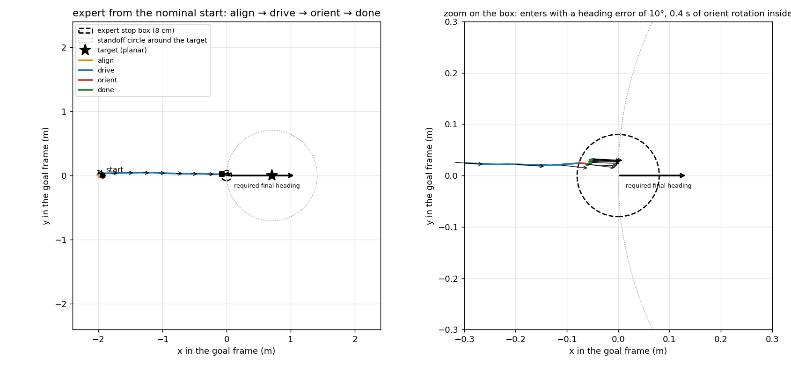
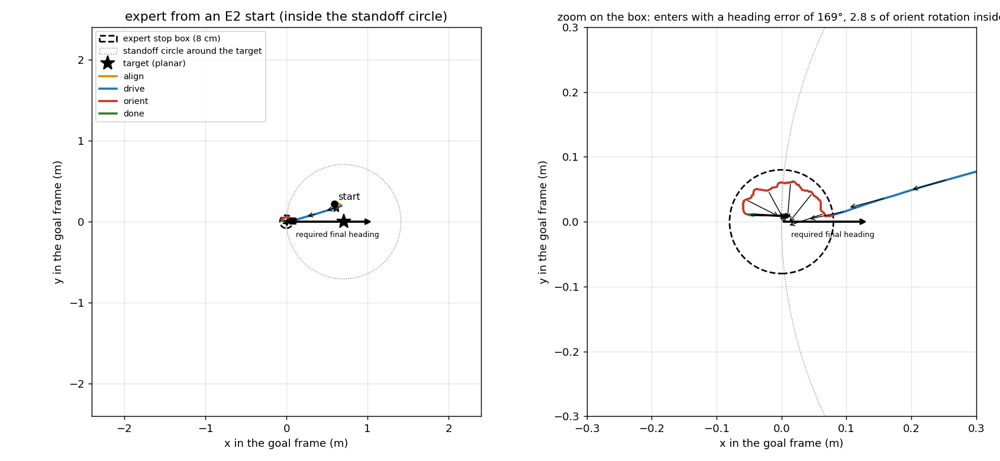
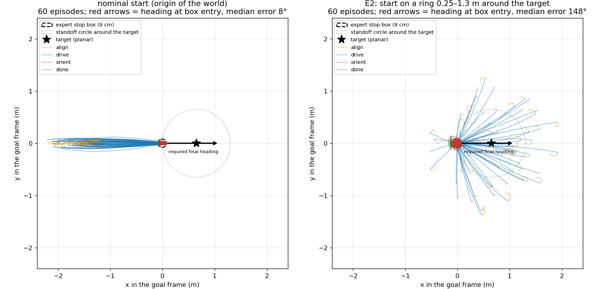
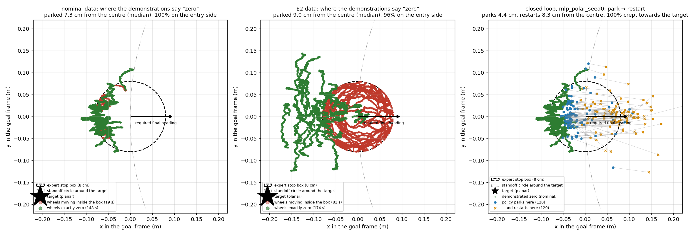
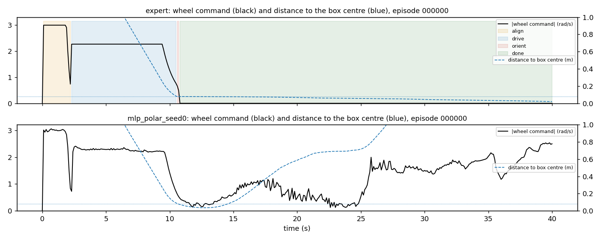

# The stop zone, drawn (2 Nov 2026)

Companion to `BLACKBOX_PLAN_20261027.md` §6i, §6o and §8: what the expert's stop region looks like, where the
demonstrations say "wheels zero", how the expert enters that region from the nominal start and from the E2 ring, and
where the learned policy ends up. Figures by `scripts/analysis/stop_zone_figures.py` (data-based: 60 nominal and 60 E2
successful demonstrations, the closed-loop traces of the MLP 28 control seed 0 on the 205 clean validation goals).

Everything is drawn in the **goal frame**: origin at the expert's base goal, x axis along the goal bearing, so the target
sits on the positive x axis at the standoff distance (0.65 m for most targets) and the required final heading is 0.

## How the expert defines its stop

```
goal_bearing = atan2(target_y, target_x)              # direction from the WORLD ORIGIN to the target
goal         = target_xy - standoff * (cos, sin)(goal_bearing)
stop         = |base_xy - goal| < 0.08 m  AND  |heading - goal_bearing| < 0.05 rad   (then `done`, wheels 0 for ever)
```

Phases: `align` (rotate in place until facing the goal), `drive` (towards the goal, stops as soon as the base is within
8 cm of it), `orient` (rotate in place until the heading equals the goal bearing within 2.9°), `done` (zero wheels, the
arm reaches). The goal bearing is a property of the target alone: the robot must end up facing the direction origin→target
wherever it came from.

## 1. From the nominal start the stop is short and always the same



The nominal start is the world origin, which lies on the line origin→goal→target. The base drives straight along that
line, enters the box already facing the target (heading error 10° here, 8° median over 60 episodes), orients for 0.4 s and
stops. The demonstrated stop states therefore all look alike: at the entry edge of the box, facing +x.

## 2. From the E2 ring the stop is preceded by a long spin inside the box



E2 starts are 0.25–1.3 m from the target in any direction (never inside the box: the chance of landing within 8 cm of the
goal is ~0.4%). From a start inside the standoff circle the expert turns its back on the target, drives outwards to the
goal, enters the box facing away from the target (169° here) and spins at full speed for 2.8 s inside the box before
`done`. Over 60 E2 episodes the heading error at box entry is 148° median and 74% of the rows inside the box have the
wheels moving.

## 3. Entry directions, 60 episodes each



Left: every nominal demonstration enters from the left, facing +x. Right: E2 demonstrations enter from every side, facing
every direction. The red arrows are the heading at box entry.

## 4. Where the data say "zero", and where the policy actually parks



- **Nominal data (left):** the rows with wheels exactly zero form a crescent at the entry edge of the box, 7.3 cm from
  its centre (median), 100% on the entry side. The expert stops the instant it crosses the 8 cm boundary, so no
  demonstration ever sits in the centre or the far half of the box, let alone beyond it.
- **E2 data (middle):** the zero rows spread a little wider (9.0 cm, still 96% on the entry side), and the inside of the box
  is now filled with moving rows (red): the `orient` spins of figure 2. In the nominal data the box holds 19 s of moving
  rows against 148 s of zeros; in E2, 81 s against 174 s. For a regressor that sees only the current pose, "inside the
  box" now reads as "rotate".
- **Closed loop (right):** the MLP 28 parks 4.4 cm from the centre, already deeper than any demonstrated zero, with a
  residual command of 6–10% of its driving level; it creeps across the box (100% of the 120 park→restart events move
  towards the target) and restarts 8.3 cm from the centre on the far side, where the nearest demonstrations are drive
  rows. Nothing in either dataset covers the far half of the box.

## 5. The same episode in time



Expert (top): align at full rotation, drive at constant speed, a 0.3 s orient, then the command is exactly zero and the
base stays 8 cm from the box centre for 30 s. MLP 28 (bottom): the same align and drive, a stop near the right place, then
the command does not reach zero, the distance to the centre passes through its minimum and grows while the command
climbs, and by 25 s the base is driving away.

## What this means for the remedies tried

- E7a/E7b/E7c make the regressor's zero exact *on the green crescent*. The policy fails on the far side of the box, where
  there is no data to weight, no median to take and no zero bin to vote for.
- E2 was meant to fill the box with stop states. It fills it with `orient` rotations, because the expert's required
  heading is fixed by the target and a robot arriving from any other direction has to spin inside the box first.
- Data that cover the box *with zeros* would need starts already inside the box and already facing the goal bearing
  within 2.9°, i.e. the collector would need the expert's goal and tolerance to choose where to start. That is the same
  knowledge that made the MLP 32 inputs privileged, placed in the collector instead of the network. Whether that is
  acceptable for the brief is Rodrigo's decision (see §8 of the plan).
